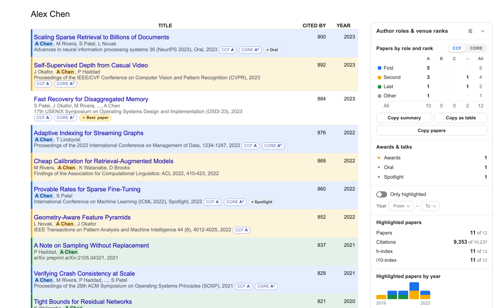

<div align="center">


# Better Scholar

**Supercharge Google Scholar. Author roles, CCF & CORE ranks, awards, impact metrics, and instant search — with zero dependencies.**

[](LICENSE)
[](https://github.com/boyugou/better-scholar)
[](https://github.com/boyugou/better-scholar/actions)
[](package.json)
[](src/_locales)
[](PRIVACY.md)

[Website (30 Languages)](https://boyugou.github.io/better-scholar/) · [简体中文](README.zh-CN.md) · [Install](#install) · [Key Features](#key-features) · [Search Operators](#instant-search--query-operators) · [Architecture](#how-it-works) · [Export Formats](#multi-format-export) · [AI & Web Agents](#ai--agent-native-dom-bridge) · [Privacy](PRIVACY.md)

<br>


<br><br>

<table>
  <tr>
    <td align="center" width="50%"></td>
    <td align="center" width="50%"></td>
  </tr>
  <tr>
    <td align="center"><sub>Profile decoration: author position tints, CCF & CORE chips, interactive panel & filters</sub></td>
    <td align="center"><sub>Settings Studio: live preview, academic theme palettes, WCAG contrast verification, role toggles</sub></td>
  </tr>
</table>

</div>

---

Better Scholar is a Manifest V3 browser extension that turns [Google Scholar](https://scholar.google.com) profile pages into an analytical, high-fidelity academic workspace. It automatically infers authorship roles (first, co-first, second, last author), matches publication venues against **CCF** (2026 7th ed) and **CORE** (ICORE 2026) catalogues, surfaces conference distinctions and awards, computes interactive impact metrics, and provides keyboard-driven instant search with query operators.

- **Local-first & Zero dependencies.** Completely self-contained. No external runtime dependencies, no build step, no npm bundle overhead. Load `src/` directly in Developer mode.
- **Precision-first venue matching.** Venues and journals are parsed separately through strict multi-stage token canonicalisation. Zero fuzzy substring guessing. When a venue is unrecognised, the panel lists it explicitly rather than assigning a speculative badge.
- **Authorship role detection.** Distinguishes first, co-first (shared contribution symbols `*`, `†`), second, and senior/last authors. Automatically highlights the owner's name in author lists with detailed position tooltips.
- **Bundled conference awards & talk levels.** Recognises 7,830+ official paper awards (Best Paper, Outstanding, Distinguished, Test of Time) across top CS venues, plus author-written Oral / Spotlight / Highlight labels.
- **Interactive impact filtering.** Click any cell in the Role × Rank matrix, or click the **H-index** and **i10-index** rows to instantly filter the publication list to your H-core or high-impact papers.
- **Instant search with operator autocomplete.** Press `/` to focus the search bar. As you type operator prefixes (`role:`, `ccf:`, `core:`, `>`, `has:`), an interactive suggestion popover appears. Use <kbd>↑</kbd> / <kbd>↓</kbd> and <kbd>Enter</kbd> / <kbd>Tab</kbd> to autocomplete. Press <kbd>Escape</kbd> anywhere to clear.
- **1-Click multi-format export.** Copy publication data to clipboard as BibTeX (with compile-ready LaTeX escaping and Scholar URLs), APA 7th edition, JSON, Markdown, CSV, Summary text, or Tab-separated table. Export directly from the in-page panel or the toolbar popup on any profile.
- **Configuration Presets & Academic Theme Studio.** Includes 1-click presets (`🚀 All features`, `🎓 Senior author focus`, `🥇 First author focus`, `⚡ Minimalist`), 5 coordinated color presets (`Classic Scholar`, `Ocean Sapphire`, `Sunset Orchid`, `High Contrast Pro`, `Nordic Slate`), per-role color customization with live WCAG AA contrast ratio calculations, full-width segmented controls, and a searchable language selector.
- **AI & Web Agent DOM Event Bridge.** Native CustomEvent bus on `document` (`better-scholar:ping`, `better-scholar:request-papers`, `better-scholar:request-export`, `better-scholar:query`) and runtime messaging (`rr:papers`, `rr:export`) for headless AI agents and research workflows.
- **30 languages.** Packed with translations for 30 locales. Supports bidirectional Scholar language synchronisation (`hl=`).
- **Private by design.** No accounts, no telemetry, no tracking, and no external network calls. Syncs user preferences through your browser's native `chrome.storage.sync`. See [`PRIVACY.md`](PRIVACY.md).

## How it works

```
Google Scholar Profile DOM  ──► content/scholar.js (DOM reader & polite auto-loader)
                                     │ raw rows: title, authors text, venue text, citations, year
                                     ▼
                                lib/analysis.js
                                     │
        ┌────────────────────────────┼────────────────────────────┐
        ▼                            ▼                            ▼
  lib/names.js                 lib/venues.js                lib/marks.js
owner & author roles        CCF / CORE tier matcher        awards & talk levels
(first, co-first, last...)    ◄── ccf.js, core.js, aliases   ◄── bundled awards.js
        │                            │                            │
        └────────────────────────────┼────────────────────────────┘
                                     ▼
                               content/main.js
                     (reactive state, query filters, DOM observers)
                        │                       │
                        ▼                       ▼
                content/panel.js         Row Decorations
              (role × rank matrix,       (role tints, rank chips,
               h-core & year bars)        marked owner names)
                        │
                        ├─► 1-Click Export (BibTeX, APA, JSON, Markdown, CSV)
                        ├─► Operator Autocomplete (`role:`, `ccf:`, `>100`)
                        └─► Agent DOM Event Bridge (`better-scholar:*` CustomEvents)
```

The parsing core in `src/lib/` is completely **pure** (free of DOM and `chrome.*` APIs). Each file attaches to `globalThis.RolesRanks` in the extension and exports as CommonJS under Node.js, allowing the entire 416-test suite to execute directly without compilation.

## Key Features

### 1. Authorship Roles & Name Marking
- **Positions recognized:** First author, Co-first (equal contribution marks `*`, `†`), Second author, and Last author (senior author).
- **Owner highlighting:** Highlights the profile owner's name in author strings (e.g. `"First author · position 1 of 8"`).
- **Hidden senior-author resolution:** When Google Scholar cuts off long author lists with `…`, **Read full lists** retrieves complete author lists asynchronously from paper detail pages, resolving previously hidden senior authorship.
- **Name variants & CJK reordering:** Automatically handles initials clustering (`GE Hinton` $\leftrightarrow$ `Geoffrey Hinton`) and Chinese family-name-first order (`Zhang Wei` $\leftrightarrow$ `W Zhang`).

### 2. Explainable Venue Matching (CCF & CORE)
- **Precision over recall:** Matches strictly by canonical token equality, strong acronym boundaries, and unambiguous prefix lookups.
- **Separate conference & journal indices:** Correctly disambiguates homonymous events (e.g., IEEE Transactions vs. annual symposia).
- **Secondary track filtering:** Excludes non-archival tracks (workshops, demos, posters, extended abstracts) unless the official venue name itself includes the term.
- **Transparent provenance:** Hover any badge to inspect the exact matching rule, official venue title, and dataset edition.

### 3. Bundled Paper Awards & Distinctions
- **7,830+ Curated Awards:** Rigorously cross-referenced from official conference award pages and the ACL Anthology. Covers Best Papers, Outstanding Papers, Distinguished Papers, and Test of Time prizes across major computer science venues (NeurIPS, ICML, ICLR, CVPR, ICCV, ECCV, ACL, EMNLP, NAACL, AAAI, IJCAI, SIGCOMM, S&P, CCS, USENIX Security, SIGMOD, VLDB, OSDI, SOSP, and dozens more).
- **Presentation tiers:** Detects author-written *Oral*, *Spotlight*, and *Highlight* distinctions with precision filters to avoid false positives (e.g. *Oral Oncology*).

### 4. Interactive Summary Panel & Impact Filtering
- **Role × Rank Matrix:** Toggle between CCF and CORE rankings. Click any cell to isolate matching publications in the DOM.
- **H-Core & High-Impact Filters:** Click the **h-index** row to show publications with citations $\ge h$. Click the **i10-index** row for publications with $\ge 10$ citations.
- **Publication timeline:** Visualises up to 50 years of publication output with clickable year bars.
- **Polite automatic loader:** Google Scholar shows only 20 or 100 papers per page. Better Scholar automatically clicks "Show more" until the full list is loaded, respecting rate limits and failing soft if Scholar stalls.

---

## Instant Search & Query Operators

Press `/` anywhere on a Google Scholar profile to instantly jump to the search box, or click the `/` keyboard badge. When typing operator prefixes (`role:`, `ccf:`, `core:`, `>`, `has:`), Better Scholar displays an accessible autocomplete menu with color-coded category badges. Use <kbd>↑</kbd> / <kbd>↓</kbd> to select and <kbd>Enter</kbd> or <kbd>Tab</kbd> to accept.

| Operator | Syntax Examples | Description |
|---|---|---|
| **Citations** | `>100`, `>=50`, `<10` | Filter publications meeting citation threshold |
| **Year** | `>2020`, `<=2015`, `year:>=2021` | Filter publications by publication year |
| **Venue Tier** | `ccf:a`, `ccf:b`, `core:a*`, `core:a` | Match CCF or CORE tier |
| **Author Role** | `role:first`, `role:last`, `role:second`, `r:cofirst` | Match specific authorship role |
| **Distinctions**| `has:award`, `is:award`, `has:talk` | Filter award winners or oral/spotlight talks |
| **Combined** | `ccf:a role:first >100 >2020 CVPR` | Multi-token AND filtering across all fields |
| **Reset** | Press <kbd>Escape</kbd> or click *Clear* | Clear all active search queries and filters |

---

## Multi-Format Export

Export filtered or full publication lists with a single click:

- **Copy BibTeX:** Generates standard, compile-ready BibTeX entries with citekeys (`AuthorYear`), properly escaped LaTeX characters (`&`, `%`, `_`), and canonical Google Scholar URLs.
- **Copy APA:** Synthesizes standard APA 7th edition reference lists (`Authors (Year). Title. *Venue*. URL`) ideal for CVs, faculty dossiers, grant proposals, and papers.
- **Copy JSON:** Exports structured academic records including titles, authors, venues, year, citation counts, role classifications, CCF/CORE tiers, and awards.
- **Copy Markdown:** Produces formatted GitHub-Flavored Markdown publication lists with hyperlinked titles and bold tier chips.
- **Export CSV:** Downloads an RFC-4180 compliant CSV file with UTF-8 BOM encoding for seamless Excel import.
- **Copy Summary / Table:** Copies the Role × Rank summary table as plain text or tab-separated spreadsheet values.

---

## AI & Agent-Native DOM Bridge

Better Scholar includes a first-class DOM event bridge for AI agents, browser automation tools, and devtools consoles operating directly in the page context:

```javascript
// 1. Check readiness and retrieve profile overview
document.addEventListener("better-scholar:pong", (e) => console.log("Profile:", e.detail));
document.dispatchEvent(new CustomEvent("better-scholar:ping", { detail: { requestId: "req-1" } }));

// 2. Query structured paper array
document.addEventListener("better-scholar:response-papers", (e) => console.log("Papers:", e.detail.papers));
document.dispatchEvent(new CustomEvent("better-scholar:request-papers", { detail: { requestId: "req-2" } }));

// 3. Export formatted BibTeX or JSON directly
document.addEventListener("better-scholar:response-export", (e) => console.log("Export:", e.detail.text));
document.dispatchEvent(new CustomEvent("better-scholar:request-export", { detail: { format: "bibtex", requestId: "req-3" } }));

// 4. Trigger programmatic search filtering
document.dispatchEvent(new CustomEvent("better-scholar:query", { detail: { query: "ccf:a role:first >100", requestId: "req-4" } }));
```

External extension components can also communicate via Chrome runtime messaging using `{ type: "rr:papers" }`, `{ type: "rr:export", format: "json" }`, or `{ type: "rr:filter" }`.

---

## Install

### Chrome & Chromium Browsers (Edge, Brave, Arc, Opera)

1. Clone or download this repository.
2. Open `chrome://extensions` in your browser.
3. Turn on **Developer mode** in the top-right corner.
4. Click **Load unpacked** and select the [`src/`](src/) directory.
5. Navigate to any Google Scholar author profile (e.g. `scholar.google.com/citations?user=...`).

> [!TIP]
> After pulling updates (`git pull`), click the reload icon on the Better Scholar card at `chrome://extensions` and refresh open Scholar tabs.

### Packaged Distribution

To generate a clean production zip for sharing or upload:

```bash
scripts/package-chrome.sh      # Outputs to dist/better-scholar-chrome-<version>.zip
```

---

## Repository Layout

```
better-scholar/
├── src/                    Chrome Manifest V3 extension (load unpacked from here)
│   ├── manifest.json       Permissions: storage only; content scripts on Scholar
│   ├── background.js       Relays settings page requests
│   ├── content/            Scholar adapter, panel UI, chips, detail reader, styles
│   ├── lib/                Pure logic: names, venues, metrics, marks, awards, prefs
│   ├── data/               Bundled CCF/CORE rankings & curated venue aliases
│   ├── options/            Settings page with live preview and configuration manager
│   ├── popup/              Toolbar popup with quick summary matrix
│   └── _locales/           Translations for 30 interface languages
├── data/                   Official ranking datasets (CCF PDF extract & ICORE export)
├── scripts/                Build tools, CCF extractor, domain updater, packaging
├── test/                   Comprehensive test suites (416 unit tests + 76 e2e checks)
│   ├── fixtures/           Real-world Google Scholar profile and venue corpora
│   └── e2e/                Chromium end-to-end tests with fixture server
├── docs/                   Architecture documentation, store assets, roadmaps
└── contrib/safari/         Best-effort Safari wrapper generator
```

---

## Development & Testing

All tests run on Node.js without third-party dependencies:

```bash
npm test            # Run all 416 unit tests (names, venues, metrics, i18n, integrity)
npm run test:e2e    # Run all 76 Chromium E2E checks with headless browser & mock Scholar server
npm run test:update # Review and update snapshots when venue rules are intentionally improved
npm run data        # Rebuild src/data/{ccf,core}.js from data/*.json
```

---

## Documentation & Governance

- [**AI & Agent Interoperability Guide (`AGENTS.md`)**](AGENTS.md): Event bus protocols, message APIs, and headless automation.
- [**Development Roadmap (`ROADMAP.md`)**](ROADMAP.md): Architectural pillars, recent milestones, and upcoming technical lanes.
- [**Contributing Guidelines (`CONTRIBUTING.md`)**](CONTRIBUTING.md): Code style, testing standards, and pull request workflows.
- [**Security Policy (`SECURITY.md`)**](SECURITY.md): Vulnerability reporting instructions and supported versions.
- [**Privacy Policy (`PRIVACY.md`)**](PRIVACY.md): Offline-first, local-only data processing guarantees.

---

## Data Provenance

| Dataset | Edition | Scope | Official Source |
|---|---|---|---|
| **CCF Recommendations** | 2026 (7th Edition) | 386 Conferences + 295 Journals | [ccf.org.cn](https://www.ccf.org.cn/Academic_Evaluation/By_category/) (Reproducibly extracted from official PDF) |
| **CORE Conference Ranks** | ICORE 2026 | 800 Ranked Conferences | [portal.core.edu.au](https://portal.core.edu.au/conf-ranks/) (Official export) |
| **Conference Awards** | Curated Corpus | 7830 paper awards | [ACL Anthology](https://aclanthology.org), Computer Vision Foundation (CVF), ACM SIGs, IEEE TCs |

Ranking lists are the property of their respective creators and are included for reference — see [`NOTICE`](NOTICE).

---

## Platform Policy

Chrome is the primary supported platform. Architectural, API, and UI/UX decisions are tailored for Chrome Manifest V3. No shims or polyfills are used to compromise Chrome functionality for other browsers. Other Chromium-based browsers (Edge, Brave) run the identical package. Experimental Safari support lives in [`contrib/safari/`](contrib/safari/README.md) as a generated wrapper.

---

## License

Licensed under the [Apache License 2.0](LICENSE).
Ranking datasets remain the property of their respective organizations (see [`NOTICE`](NOTICE)).
