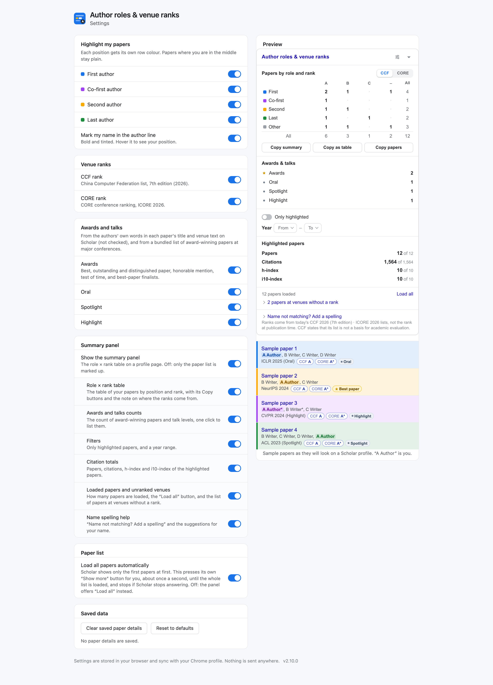

# Better Scholar

**Supercharge Google Scholar profiles.** A Chrome extension that reads a [Google Scholar](https://scholar.google.com) profile and shows, for every paper, the author's role (first / co-first / second / last…), CCF and CORE venue ranks, conference awards, year distribution charts, and instant in-page search — then adds them up: *"first-author CCF-A papers: 4"*.

[](https://github.com/boyugou/better-scholar/actions/workflows/test.yml)

[简体中文](README.zh-CN.md) · [Website (30 languages)](https://boyugou.github.io/better-scholar/)

<p align="center"></p>
<p align="center"><sub>A fictional profile (real venue names, invented papers): rows tinted by author role, CCF / CORE chips on the venue line, the role × rank summary on the right.</sub></p>
<p align="center"></p>
<p align="center"><sub>The settings page (sliders button in the panel or the toolbar popup): choose what is shown, with a live preview.</sub></p>

- **Role × rank summary & multi-format export** — a small matrix in the page: first / co-first / second /
  last × CCF A / B / C / unranked (switch to CORE A\* / A / B / C). Click a cell to
  list exactly those papers. Export with 1-click: *Copy summary* and *Copy as table* put the matrix on the clipboard for a CV or an application form;
  *Copy papers* exports plain text (one line each with role, ranks, awards, citations); *Copy Markdown* generates clean GitHub-Flavored Markdown publication entries with clickable links and formatted tiers; *Copy BibTeX* generates compile-ready, LaTeX-escaped BibTeX entries with direct Scholar URLs.
- **Instant quick search & advanced operators** — press `/` to instantly search papers by title, authors, venue, acronyms, awards, or years with multi-token AND matching. Power through large corpora with query operators:
  - Citation thresholds: `>100`, `>=50`, `<10`
  - Publication years: `>2020`, `<=2015`, `year:>=2021`
  - Venue tiers: `ccf:a`, `ccf:b`, `core:a*`, `core:a`
  - Author roles: `role:first`, `role:last`, `role:second`, `r:cofirst`
  - Distinctions: `has:award`, `is:award`, `has:talk`
  - Combine seamlessly: `ccf:a role:first >100 >2020 CVPR`. Press `Escape` anywhere to clear all filters.
- **Role colours on every paper** — each row is tinted by the author's position
  (blue first, purple co-first, amber second, green last) and your name in the author line is marked
  (hover it: "First author · position 1 of 8"). Quiet rank chips (`CCF A`, `CORE A*`) sit on the venue
  line; hover one to see which venue it matched, by which rule, and the list edition.
- **Accurate, explainable venue matching** — built against real Scholar data, not
  guesses. Conferences and journals are matched separately; truncated names
  (`…on Computer Vision and Pattern …`), `ISCA 2014 42 (3)`, `[arXiv…]` annotations,
  `Findings`/workshop/demo tracks are all handled. When a venue is not recognised the
  panel lists it instead of guessing.
- **Awards and talk levels** — a paper gets a small chip (gold ★ for an award, silver for an honorable mention, slate for a talk level) when its title or venue
  text says *Oral*, *Spotlight*, *Highlight* or an award (*Best / Outstanding / Distinguished Paper*, *Test
  of Time*), or when it is on a bundled list of award-winning papers from the conferences' own award pages
  (the ACL family, ICLR, NeurIPS and ICML; CVPR, ICCV and ECCV from the Computer Vision Foundation's own award list, test-of-time prizes included; AAAI; IJCAI 2020–2023; USENIX's best papers; SIGIR and KDD; the SIGSOFT distinguished papers of ICSE, FSE and ASE; STOC and SIGCOMM best papers, the IEEE S&P and NDSS distinguished papers, SIGMOD and PODS best papers, the ACM CCS best and distinguished papers, the best papers and honorable mentions of CHI, CSCW, UIST and other SIGCHI conferences from SIGCHI's own programs, and the test-of-time awards of CCS, VLDB, WWW, ISCA, MICRO, USENIX and SIGMOD, with PODC / DISC's Dijkstra Prize SIGPLAN's Most Influential Paper Awards of POPL, PLDI, ICFP and OOPSLA, and SIGMETRICS's best, student and test-of-time papers). The panel counts them and a click lists just those
  papers. A chip's tooltip says whether it came from the author's words or from the award list.
- **Hidden senior-author roles** — Scholar cuts long author lists with `…`, which
  hides the last author on large papers (on one well-known PI's profile, 30 of the
  first 100 papers). **Read full lists** reads those papers' own pages (about one a second,
  only when you click) and fills the roles in.
- **Metrics & interactive impact filtering** — view papers, citations, h-index, and i10-index for highlighted papers, plus year ranges and distribution charts. The **h-index** and **i10-index** rows are interactive filter buttons: click to instantly isolate your H-core ($\ge h$ citations) or high-impact ($\ge 10$ citations) publications. Whenever a filter narrows the list the panel says so ("Showing 25 of 100 papers · Clear"). **The whole paper list loads by itself**: Scholar shows only the first papers and hides the rest behind *Show more*, so the extension
  presses that button for you (about once a second, and it stops at once if Scholar stops answering). A setting turns it off; the panel then
  offers **Load all**.
- **Cleaner profiles & fine-grained hiding** — (all optional, in the settings) merge duplicate entries that list one paper twice (same title apart from capitals and punctuation, same first author: the most cited stays and shows the sum), independently hide Scholar's "Cited by" metrics table or yearly citation chart, hide "Co-authors" and "Public access" blocks, pick your own role colours, see highlighted papers by year, put Oral / Spotlight / Highlight in one row, and read cut-off author lists from Semantic Scholar first (it receives only the title) so Scholar sees fewer requests.
- **AI & Agent-native configuration & APIs** — 1-click export and import your full extension configuration and profile identity via clean JSON or TOML. Web agents and automated research workflows can query the profile state via runtime messages (`rr:papers`, `rr:filter`, `rr:export`) or DOM custom events (`better-scholar:query`). Inspect cached resolved papers anytime with the built-in Saved Paper Details Cache Viewer in Settings.
- **30 languages** — the interface follows the browser or the language you pick, and a Scholar profile or search page opened in another language (a shared link, say) can be reopened in yours.
- **You decide what is shown** — the sliders button (in the panel header and the toolbar popup) opens a
  settings page: which author positions to colour, whether to mark your name, the CCF and CORE chips, each
  of Awards / Oral / Spotlight / Highlight, the summary panel and each of its parts (the role × rank table, its copy buttons, the awards and talks counts, the filters, the citation totals, the loaded-papers status, the name help — keep the filters and totals, say, without the table),
  and whether the whole paper list loads by itself. Each group of switches has *Enable all* and *Disable all*. A live preview shows the result and open Scholar tabs update at once; whatever you switch
  off disappears from the page instead of staying as a control.
- **Private by design** — no accounts, no analytics, no tracking, and no third-party request unless you switch on the optional Semantic Scholar lookup (it receives only a paper's title). The
  rankings are bundled in the extension. Settings sync through your Chrome account.
  See [`PRIVACY.md`](PRIVACY.md).
- **Easy to correct** — a venue that has no rank? *Report* in the panel opens a pre-filled issue with the
  venue text (and *Copy list* copies it); see [`CONTRIBUTING.md`](CONTRIBUTING.md).

It works on **profile pages** (`scholar.google.com/citations?user=…`) on every
Scholar domain. The interface comes in 30 languages.

## Install

**Chrome** (also Edge and other Chromium browsers):

1. Open `chrome://extensions` and enable **Developer mode**.
2. Click **Load unpacked** and select this repository's `src/` folder.
3. Open a Google Scholar author profile.

After updating the folder (`git pull`), click the reload icon on the extension's card at `chrome://extensions` and refresh open Scholar tabs: Chrome keeps the old scripts of an unpacked extension until it is reloaded, while the interface texts are read again at every page load, so an old script can show a text key instead of a word.

No build step, no dependencies. To make a zip (for sharing, or a store upload):

```bash
scripts/package-chrome.sh      # → dist/better-scholar-chrome-<version>.zip
```

## What it can and cannot know

- **Ranks are today's, not the rank at publication time.** A 2009 paper in a venue
  that is CCF-A now shows `CCF A`. CCF also states that its list is *not a basis for
  academic evaluation*, and counts only full papers at conferences — the extension excludes
  Findings, workshops, demos, posters and similar tracks, but cannot tell a short
  paper from a full one in Scholar's text.
- **The lists are computer science's.** CCF and CORE rank computer-science venues; a biologist's or a
  physicist's journals are not on them. When no paper of a profile is, the table counts papers by role only
  (no empty rank columns) and says why; the roles, years, totals and the rest work in any field.
- **Roles come from Scholar's author text.** Initials are matched flexibly
  (`GE Hinton` = `Geoffrey Hinton`; `Jane` ≠ `John`), but two different people can
  collide on `W Wang`. Equal-contribution marks (†, ∗, # …) count when the first author and at least one other
  leading author carry them (`A*, B*, C`); a lone mark, or one further down (a corresponding or co-senior author), says nothing about
  the role. Scholar rarely preserves marks at all. A profile name written surname first (`Tang Jie` on the profile, `J Tang` in the
  papers) is read the other way round automatically when the page itself shows that this finds you and the
  name as printed hardly does; other rearrangements Scholar prints (`SY Philip` for `Philip S. Yu`) and an inventor in capitals (`JA DOUDNA` in a patent, when the same initials written as usual already find you elsewhere on the profile) are offered
  with one click when they occur in at least two papers. Anything else: **Add a spelling** in the panel.
- **Awards are not exhaustive.** The award list covers the venues above and only the years their pages
  publish; a paper that is not on it has no award chip. Talk levels (*Oral*, *Spotlight*) are only what the
  author wrote — Scholar's text rarely carries them — and look-alikes such as *Oral Oncology* are never marked.
- **Venue strings are messy.** What Scholar prints is owner-editable and often
  truncated. Anything unrecognised is listed ("papers at venues without a rank") so you
  can see what is missing; there is no fuzzy guessing.
- **Read full lists** talks to Google Scholar (the paper's own page, same-origin, throttled,
  cached). Google may show a CAPTCHA after heavy use; it stops at the first sign of
  one and tells you.
- Search-result pages are not supported: they carry neither the profile owner nor
  complete venue names.

## Data

| Dataset | Edition | Source |
|---|---|---|
| CCF recommended venues | 2026 (7th edition), 386 conferences + 295 journals | [ccf.org.cn](https://www.ccf.org.cn/Academic_Evaluation/By_category/) PDF, extracted reproducibly — see [`data/README.md`](data/README.md) |
| CORE conference ranks | ICORE 2026, 800 ranked conferences | [portal.core.edu.au](https://portal.core.edu.au/conf-ranks/) export |
| Paper awards | 7830 paper awards (ACL family, ICLR, NeurIPS, ICML, CVPR, ICCV, ECCV, AAAI, IJCAI 2020–2023, USENIX, SIGIR, KDD, SIGSOFT, STOC, SIGCOMM, S&P, CCS, NDSS, SIGMOD, PODS, VLDB, WWW, ISCA, MICRO, PODC / DISC, POPL / PLDI / ICFP / OOPSLA, SIGMETRICS, FOCS, SIGOPS Hall of Fame, SOSP's, RecSys's, AISTATS's, UAI's, ICASSP's, COLING's, Interspeech's, ECML PKDD's, INFOCOM's, Euro S&P's, WSDM's, PPoPP's, CIKM's, IPDPS's, ICS's, ECIR's, GECCO's, CIDR's, BMVC's, VRST's, HRI's, ICC's, WCNC's, GLOBECOM's, CCC's, CCNC's, PIMRC's, NOMS's, MICCAI's, ECAI's, SAT's, ICDT's, ESA's, ICALP's, MFCS's, ICGT's, SoCG's, CADE's, IJCAR's, DSN's, FPGA's, FCCM's, ICCAD's, UMAP's, BPM's, RECOMB's, SPAA's, CASES's, CODES+ISSS's, EMSOFT's, HSCC's, DATE's, ASP-DAC's, MobiSys's, ACM MM's, IEEE VR's, ASSETS's and AutomotiveUI's best papers, EuroSys test of time, AAMAS's and ASPLOS's influential papers, the IACR test of time (CRYPTO / EUROCRYPT / ASIACRYPT), the TCC, PKC and CHES tests of time, HPCA's, IMC's and IEEE VIS's test of time, ICDE's influential papers, ISMAR's best and impact papers, ICSE's most influential papers, LICS's test of time and distinguished papers, AAAI's classic papers, ICAPS's influential papers, ISWC's ten-year papers, SIGMM's test of time, Hypertext's and DocEng's best papers, SIGDA's Newton technical impact award, SIGSPATIAL's best and 10-year impact papers, SIGCSE's test of time, ICWSM's test of time and best papers, SIGMOBILE's and SenSys's test of time (SenSys's best papers 2020, 2021 and 2024 too), SIGecom's test of time, and CHI, CSCW, UIST and other SIGCHI conferences; best papers, honorable mentions and test-of-time awards; not exhaustive) | [ACL Anthology](https://aclanthology.org) metadata (CC BY 4.0), the Computer Vision Foundation's, SIGCHI's and each conference's own awards pages — every entry cites its page; see [`data/README.md`](data/README.md) |

The rank lists are included for reference and are the property of their owners — see
[`NOTICE`](NOTICE). Regenerate with `npm run data`.

## Development

Contributions welcome — [`CONTRIBUTING.md`](CONTRIBUTING.md) explains how to fix a venue with real strings.

```bash
npm test            # unit tests: names, venues (real-profile corpora), metrics, package checks
npm run test:e2e    # loads the extension into Chromium against a local Scholar stand-in
npm run data        # rebuild src/data/*.js from data/*.json
```

The e2e test needs Playwright and a Chromium build (branded Chrome ≥137 ignores
`--load-extension`); see the header of [`test/e2e/run.mjs`](test/e2e/run.mjs).
Architecture and the matching rules: [`docs/ARCHITECTURE.md`](docs/ARCHITECTURE.md).

## Platform policy

Chrome is the main line. Features, extension APIs and UI/UX are designed for Chrome;
compatibility with other browsers never constrains them.

| Browser | Status |
|---------|--------|
| **Chrome** | **Primary** — developed and checked here first. |
| Edge, Brave, other Chromium | Expected to work (same MV3 package); not regularly tested. |
| Safari (macOS) | **Best-effort / experimental.** Lives in [`contrib/safari`](contrib/safari/README.md); may lag behind or break, with no support commitment. |

## Repository layout

```
src/                     the extension — load this folder in Chrome
  manifest.json          MV3, permission: storage only; content script on /citations* pages
  background.js          four lines: opens the settings page when the panel's button asks
  lib/                   pure logic: names, venues (matcher), metrics, marks, awards, prefs, analysis
  content/               Scholar adapter, panel UI, chips, detail-page reader, styles
  data/                  bundled rankings (generated) and curated venue aliases
  popup/                 toolbar popup (the same summary for the active tab)
  options/               settings page: what to show, with a live preview
  _locales/              30 languages (English, Chinese, Japanese, German, Arabic, etc.)
data/                    ranking datasets + provenance (source of src/data/*.js)
scripts/                 data builders (CCF PDF, ICORE), packaging, icon renderer
test/                    unit tests, real-profile fixtures, end-to-end test
contrib/safari/          best-effort Safari wrapper
docs/                    architecture
```

## License

Licensed under the [Apache License 2.0](LICENSE). Ranking data is excluded — see [`NOTICE`](NOTICE).
