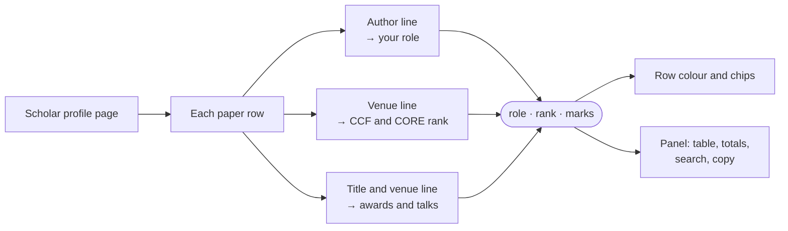
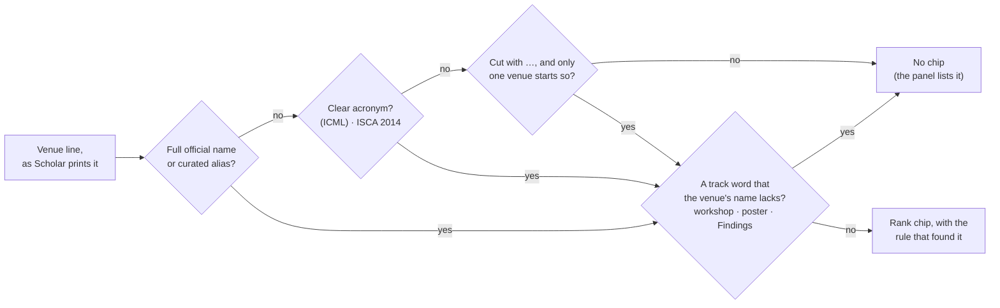
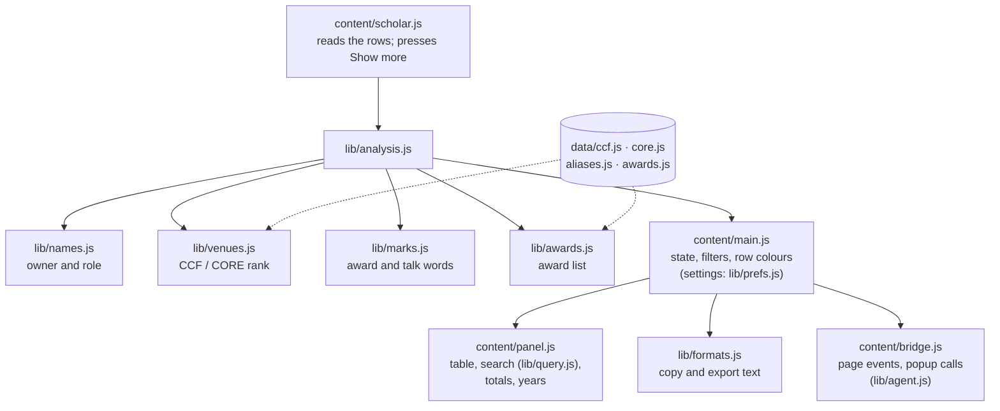

<div align="center">


# Better Scholar

**Your author role and the venue rank, on every paper of a Google Scholar profile.**

[](LICENSE)
[](https://github.com/boyugou/better-scholar)
[](https://github.com/boyugou/better-scholar/actions)
[](package.json)
[](src/_locales)
[](PRIVACY.md)

[Website (30 languages)](https://boyugou.github.io/better-scholar/) · [简体中文](README.zh-CN.md) · [Install](#install) · [How it works](#how-it-works) · [Features](#features) · [Search](#search-operators) · [Copy and export](#copy-and-export) · [For AI agents](#for-ai-agents) · [Privacy](PRIVACY.md)

<br>


</div>

## What it does

Better Scholar is a free Chrome extension for [Google Scholar](https://scholar.google.com) profile pages. It adds three things to each paper:

| On each paper | What you see |
|---|---|
| **Your role**: your place in the author line | The row gets the colour of the role: first, co-first, second or last author. |
| **The venue rank**: from the CCF (2026, 7th edition) and CORE (ICORE 2026) lists | A chip beside the venue: `CCF A`, `CORE A*`. |
| **Awards and talks**: from official award pages and from the authors' own words | A chip: `★ Best paper`, `Oral`, `Spotlight`, `Highlight`. |

A panel beside the list counts your papers by role and by rank. It also shows citation totals and papers by year, and it has a search box and copy buttons.

- **No guesses.** A venue that the lists do not hold for certain gets no chip, and the panel lists it. The tooltip of each chip names the venue, the rule that found it and the list's edition. You may tie such a venue to a listed one yourself; its chip is then dashed and every copy says "(your mapping)".
- **Private.** No account, no analytics, no tracking. All the work happens in your browser. The only request to a site other than Scholar is the Semantic Scholar lookup, which is off by default.
- **Open and simple.** Open source (Apache 2.0), with no dependencies and no build step.

<details>
<summary>More pictures: the panel, search, the settings page, the toolbar popup</summary>
<br>
<table>
  <tr>
    <td align="center" width="50%"></td>
    <td align="center" width="50%">100 narrows the list and its totals" width="460"></td>
  </tr>
  <tr>
    <td align="center"><sub>The panel: role × rank table, copy and export, awards and talks, filters</sub></td>
    <td align="center"><sub>Search: <code>role:first ccf:a cites:&gt;100</code> narrows the list and the totals</sub></td>
  </tr>
  <tr>
    <td align="center" width="50%"></td>
    <td align="center" width="50%"></td>
  </tr>
  <tr>
    <td align="center"><sub>Settings: a switch for every part, and a live preview</sub></td>
    <td align="center"><sub>Toolbar popup: the table and the copy and export buttons</sub></td>
  </tr>
</table>
</details>

## Install

1. Download this repository (**Code → Download ZIP**) and unzip it, or clone it.
2. Open `chrome://extensions`.
3. Turn on **Developer mode** (top right).
4. Click **Load unpacked** and select the [`src/`](src/) folder.
5. Open a Google Scholar profile (`scholar.google.com/citations?user=…`).

Edge, Brave, Arc, Opera and other Chromium browsers use the same steps. Safari support is best effort: see [`contrib/safari/`](contrib/safari/README.md).

> [!TIP]
> After an update (`git pull`), click the reload icon on the Better Scholar card at `chrome://extensions`. Then reload the open Scholar tabs.

## How it works

The extension reads each row of the profile's paper list. It does three lookups for each row. Then it colours the row, adds the chips and fills the panel.

<p align="center"></p>

<p align="center"><sub>Two made-up papers at real venues, read by the extension's own code. The same steps are on the <a href="https://boyugou.github.io/better-scholar/">website</a>, in 30 languages.</sub></p>

All the steps, for every paper:



### Your role

The extension finds the profile's name in each author line. Your place in the line gives the role:

| Role | When |
|---|---|
| First | You are the first author. |
| Co-first | You are in a leading group of two or more authors that share a mark, such as `*` or `†`: `A*, B*, C`. |
| Second | You are the second author, and the paper has three or more authors. |
| Last | You are the last author, and the author list is complete. In a two-author paper the second author counts as last, not second. |
| Other | Any other place. The row stays plain. |

- **Initials match.** Scholar prints `GE Hinton` for Geoffrey Hinton. The extension matches it.
- **Cut author lists.** Scholar cuts long author lists with "…". When the cut hides your place, the role is hidden too. Click **Read full lists** in the panel. The extension then reads the page of each such paper on Scholar (about one a second, and only after the click) and finds the role. If you allow it, it asks Semantic Scholar first.
- **Two authors with your spelling.** An author line can hold your spelling two times (`X Wang, X Wang, P Cong`). When the two places give different roles, the line cannot say which one is you. The paper then counts as *Other*, never as first, second or last author. On 5,000 real author lines, with OpenAlex's author positions as the truth, this rule removed every wrong first, second or last claim.
- **Other spellings.** The extension also tries your name in the other order (`Tang Jie` for Jie Tang), but only when the profile's own rows show that order. It suggests other spellings that it finds in your papers. You can add up to eight spellings per profile (**Name not matching? Add a spelling**).

### The venue rank

The lookup runs once for the CCF list and once for the CORE list. It uses no fuzzy match and no substring match:



Real examples. The middle column is what the lists give; by default the panel draws one chip (see *One chip, not two*). A test checks each row against the code:

<!-- examples:begin -->
| Scholar prints | Rank (CCF · CORE) | Found by |
|---|---|---|
| `Proceedings of the IEEE/CVF Conference on Computer Vision and Pattern Recognition (CVPR), 2023` | CCF A · CORE A* | `name` |
| `ISCA 2014 42 (3), 361-372, 2014` | CCF A · CORE A* | `acronym` |
| `Proceedings of the 2026 CHI Conference on Human Factors in …, 2026` | CCF A · CORE A* | `prefix` |
| `IEEE Transactions on Pattern Analysis and Machine Intelligence 44 (8), 4012-4025, 2022` | CCF A | `name` |
| `NeurIPS 2023 Workshop on Instruction Tuning and Instruction Following, 2023` | — | track word `workshop` |
| `Findings of the Association for Computational Linguistics: ACL 2022, 410-423, 2022` | — | track word `Findings` |
| `arXiv preprint arXiv:2105.04321, 2021` | — | — |
<!-- examples:end -->

- **Conferences and journals are separate lists.** The words of the venue line decide which list to look in. CORE ranks conferences only.
- **Track words.** Findings, workshops, demos, posters, tutorials, extended abstracts, short papers, industry papers and shared tasks are not the main venue. They get no chip, unless the word is part of the venue's official name.
- **One chip, not two.** CCF and CORE rank mostly the same venues. So by default a paper shows the CCF chip, and the CORE chip only where CCF has no rank for the venue. The CCF chip's tooltip names the CORE rank too. **CORE first** and **Both** change this. The venue list and the notes of the Markdown and BibTeX copies follow this choice. The table, the search and the other copy formats keep both lists.
- **Linked lists.** The two lists often name one venue in two ways (*ACM SIGCHI Conference on Designing Interactive Systems* and *Designing Interactive Systems*). The extension knows these pairs. A match in one list brings the other list's row of the same venue.
- **Today's ranks.** The ranks come from the current lists, not from the year of the paper. The panel and every tooltip say this.

### Awards and talks

- **The award list.** The extension holds 7,830 paper awards from official pages: best papers, best student papers, outstanding and distinguished papers, honorable mentions and test-of-time awards. The sources are the ACL Anthology's award data, the Computer Vision Foundation, and the award pages of the conferences and their societies (NeurIPS, ICML, ICLR, CVPR, ICCV, ECCV, ACL, EMNLP, NAACL, AAAI, IJCAI, SIGCOMM, S&P, CCS, USENIX Security, SIGMOD, VLDB, OSDI, SOSP, CHI and many more). A paper matches an award only when the titles are identical and the award's first author is one of the paper's authors.
- **The authors' own words.** The extension reads award words (Best Paper, Outstanding Paper, Test of Time, a best-paper finalist) and the talk kinds Oral, Spotlight and Highlight in the title or the venue line. Its rules leave ordinary words alone: *Oral Oncology* is a journal.

## Features

### The panel

- **Role × rank table**, for CCF or for CORE. Click a cell, a role or a rank to list those papers.
- **Copy row**: one button for each format that is switched on. See [Copy and export](#copy-and-export).
- **Awards and talks**: the counts. Click a count to list its papers.
- **Search and filters**: words and [operators](#search-operators); quick buttons such as *CCF A*, *>100* (citations), *First author*, *Award* and *Last 5 years*, and up to three of your own words; *Only highlighted*; a year range. The table, the award counts and the copied summary count only the papers that the filters leave. (A switch on the settings page turns this off.)
- **Citation totals**: papers, citations, h-index and i10-index of your highlighted papers, beside the totals of all papers. The **h-index** and **i10-index** buttons list the papers behind the number.
- **Papers by year**: a bar for each year (at most 50 years), in the role colours. Click a bar to list the papers it counts: your highlighted papers of that year (*From* and *To* list every paper of a range).
- **Top venues** (off by default): the ranked venues of your highlighted papers, most papers first. Click a venue to list its papers.
- **Status lines**: how many papers are loaded; the roles that cut author lists hide (**Read full lists**); duplicate entries; papers at venues neither list holds, with **Copy list**, **Report**, and a **Check** link for each venue.
- **The whole list.** Scholar shows the first papers of a profile, and more when you press its **Show more** button. By default the extension presses that button for you until the list is complete: one press at a time, about once a second, and only in the tab that you look at. It stops at the first press that brings no new papers. With **Load all papers automatically** off, the panel shows a **Load all** button.
- A bar at the top of the panel says how many papers the filters show, and clears them. `Escape` on the page clears all filters too.
- **Toolbar popup**: the table, the award counts and the copy buttons, for the profile in the open tab.

### The settings page

All settings are on one page. A change is saved at once, and open Scholar tabs redraw.

- **The preview is the real panel**, over sample rows, and you can edit it. Point at a part of the preview to hide it (✕), move it (⠿), rename it (✎) or find its setting (⚙). Double-click a name to rename it, or anything else to jump to its setting. The cards on the left follow the preview from top to bottom.
- **A switch for every thing**: each part of the panel, and each thing in a part (a title, a column, a button, a quick filter, a number). A switch decides what is drawn. What you see is what you search and copy.
- **Order**: drag the parts of the panel, the copy buttons and the quick filters on the preview, or use the buttons on the left.
- **Your own names** for titles, columns, buttons and chip words. A name replaces the translation in every language. Exports, search operators and page calls keep the standard words.
- **Colours**: five colour themes, or a colour for each role. Each role colour shows its contrast with Scholar's white page, and warns below 3:1 (the WCAG minimum for graphics).
- **Chip looks**: outline, soft, solid or text only; rounded or square; with the list's name or the tier only; a colour for CCF, CORE, awards and talks; six ready-made looks.
- **Check a venue**: paste a venue line as Scholar prints it. The page shows the CCF and CORE rank, the name it matched and the rule. For a CCF venue it also shows the research area and a link to its DBLP page. When there is no rank, it says why. A line no rule ranks can be tied by you to a listed venue (*Assign it to a listed venue…*): it then gets that venue's rank in every edition of the same name, as *your mapping* — a dashed chip, a status line, "(your mapping)" in every copy — and never over a rank the lists give. The mappings are listed below the box, each with *Remove*.
- **Presets and JSON**: *All features*, *Last author focus*, *First author focus*, *Minimalist*; copy, export, import or edit the configuration as JSON.
- A search box above the cards filters the settings. `/` jumps to it (a switch turns the key off).

<details>
<summary>The cards of the settings page, in the order of the preview</summary>

| Card | What it holds |
|---|---|
| Language | The extension's language (or follow the browser); *Open Scholar in* |
| Highlight my papers | A switch for each role; *Mark my name in the author line* |
| Colours | Five colour themes (Default, Cool, Warm, High contrast, Soft); a colour for each role, with a contrast badge; the row highlight: tint and bar, bar only, tint only, none |
| Chips on each paper | CCF, CORE, award and talk chips; which list's chip shows where both rank a venue (CCF first, CORE first, both); the names of the award chips; the look of the chips |
| Summary panel | The panel; the order of its parts; the parts of its title bar; the bar that says the list is filtered; *Compact* |
| Role × rank table, Copy & export, Awards and talks, Filters, Citation totals, Papers by year, Top venues, Loaded papers and unranked venues, Name spelling help | One card for each part of the panel: its switch, a switch (and a name) for each thing in it, and its order where it has one |
| Scholar's own blocks | Hide *Cited by* (or only its table or its chart), *Co-authors*, *Public access* |
| Duplicate entries | *Merge duplicates* |
| Paper list | *Load all papers automatically* |
| Semantic Scholar | *Read author lists from Semantic Scholar first* (off by default); an optional API key |
| Check a venue | A text box for a venue line, and what the lists make of it; your venue mappings |
| AI agents | *Copy guide for agents* |
| Configuration & presets | The presets; *Copy configuration (JSON)*, *Export file*, *Import file*; a JSON editor |
| Saved data | *View saved details*, *Clear saved paper details*, *Reset to defaults*, *Copy details for a bug report* |

- **The configuration is JSON.** The editor and *Import file* take a patch in the shape of the exported record, for example `{ "panel": { "years": { "show": false }, "copy": { "order": ["bibtex", "summary"] } }, "rows": { "style": "bar" }, "labels": { "metricsTitle": "My papers" } }`. The page says what it applied, what it ignored, and why. A preset changes only the settings that it names. No preset turns on Semantic Scholar.
- **Old settings are not migrated.** The stored record is read setting by setting. A value whose name and type still match a setting is kept. Anything else gets its default.
- Chrome accepts 120 writes a minute to synced settings. The page writes at most about 100 a minute, and it says when Chrome refuses a write.

</details>

### Languages

The extension speaks 30 languages: English, 简体中文, 繁體中文, 日本語, 한국어, Español, Français, Deutsch, Italiano, Português (Brasil), Português (Portugal), Русский, Українська, Polski, Čeština, Nederlands, Svenska, Dansk, Suomi, Norsk, Türkçe, العربية, עברית, हिन्दी, Bahasa Indonesia, Tiếng Việt, ไทย, Ελληνικά, Magyar and Română. It follows the browser's language unless you choose one. *Open Scholar in* opens Scholar's own pages (`/scholar`, `/citations`) in a language that you choose, with Scholar's `hl=` setting.

## Search operators

Press `/` on a profile to jump to the search box. (The panel and its filters must be shown. A switch on the settings page turns the key off.) A paper must match every word and every operator. A word is looked for in the title, the authors, the venue, the venue's name in the lists, the year, the role and the marks, at the start of a word: `learn` finds "learning". A word of one or two letters is a whole word: `he` finds the author He, not "the" or "Chen". A word in Chinese, Japanese or Korean is found anywhere. Capitals, accents and full-width letters do not matter: `dollar` finds "Dollár", and `ccf：a` typed with a Chinese input method is `ccf:a`.

| Operator | Examples | Matches |
|---|---|---|
| `cites:` | `cites:>100`, `cites:>=50`, `cites:<10`, `cites:25` | The citation count, compared with a number: `>` `>=` `<` `<=` `=`. A bare number means `=`. |
| `year:` | `year:>=2020`, `year:<2015`, `year:2023` | The publication year, compared in the same way. |
| `age:` | `age:<5`, `age:<=10`, `age:0` | The age of the paper in years. This year is 0, so `age:<5` is the last five years, and it stays true as the years go by. |
| `ccf:` | `ccf:a`, `ccf:b`, `ccf:c` | The venue's CCF rank. |
| `core:` | `core:a*`, `core:a`, `core:b`, `core:c` | The venue's CORE rank. |
| `role:` | `role:first`, `role:cofirst`, `role:second`, `role:last`, `role:middle` | Your place in the author list. `middle` is none of the other four. |
| `type:` | `type:conference`, `type:journal` | The kind of venue, as the rank lists say. A venue without a rank has no kind. |
| `has:` | `has:award`, `has:talk` | An award mark (best paper, test of time, honorable mention, a category award or a finalist); an Oral, Spotlight or Highlight mark. |
| `author:` `title:` `venue:` | `author:hinton`, `title:transformer`, `venue:neurips` | The word in that part of the paper only. The authors are the whole list once *Read full lists* has read it; the venue includes the paper page's own line and the venue's names in the lists. |
| words | `ccf:a role:first cites:>100 detection` | All terms together: every term must match. |
| `"…"` | `"genome editing"` | The words one after the other. |
| `-` `NOT` | `-crispr`, `NOT crispr`, `-role:first` | Papers without the word, or that the operator does not match. |
| `OR` | `cas9 OR cas12a` | Either term. Write `OR` in capitals. |

- **A comma means "or".** `role:first,last` is first or last author. `ccf:a,b` is a CCF A or B venue (`ccf:a, b` with a space is the same, and so is `、` or `،` in place of the comma). Separate words must all match. Two quick buttons of the same operator join into one word: *First author* and *Last author* give `role:first,last`.
- **Errors.** An operator with a value that it does not take (`ccf:x`) matches nothing. The box is then marked, and its tooltip says why. A word with a colon after no operator (`http://…`) is an ordinary word.
- **Suggestions.** Type an operator's colon (`role:`) to see its values. `↓`, or a click on the `/` hint, shows common searches. `↑` and `↓` choose; `Enter` or `Tab` takes the choice. Without a list, `Enter` jumps to the next matching row and `Shift`+`Enter` to the previous one.
- `Escape` closes the list, and then clears the box. On the page, `Escape` clears every filter.
- The quick buttons under the box are `ccf:a`, `cites:>100`, `role:first` and `has:award`. The settings offer more: `core:a*`, `age:<5` (*Last 5 years*), `role:cofirst`, `role:second`, `role:last` and `has:talk`. A button for a kind of paper that nothing on the page shows is left out.
- **Your own quick buttons.** Under *Settings → Filters* you can type the words of up to three buttons of your own, as you would in the box (`ccf:a role:first age:<5`, at most 60 characters), and give each a name. The button shows the name, or else the words. It puts all its words in the box and takes them out again. Its word for a role, a rank or a kind of venue takes the place of the one in the box (a paper has one role); its `has:` words are added (a paper can have an award and a talk). Words that the search cannot read make no button, and the settings page says why.
- The box takes up to 500 characters.

### Recipes

| I want… | Do this | I get |
|---|---|---|
| The table of the last five years | Press *Last 5 years* (turn it on under *Settings → Filters*) or type `age:<5` | The table, the award counts and *Copy summary* count only those papers. The copied text says so. |
| First- or last-author papers at CCF A or B venues | `role:first,last ccf:a,b` | The papers. The table counts them, and a cell such as *Last × A* lists its papers. |
| Award papers of the last ten years | `has:award age:<10` | Those papers, and their count in the table. |
| Papers at ranked journals with more than 100 citations | `type:journal cites:>100` | The list, and the citation totals of the highlighted ones. |
| The papers with a given co-author | Press *Read full lists* once, then type the surname | Every paper with that name anywhere in its author list. |
| The papers that may not be the person's | Click the status line "N papers where the profile owner's name is not in the author list" | Those papers, to check or to report. |
| A summary to file or send | *Copy summary* or *Copy as table* | The table as text (or as a real table in Word), the lists' edition, what was counted, and a line with the profile's link and the date. |

## Copy and export

Each format is a button in the panel's copy row and in the toolbar popup. Each has its own switch under *Settings → Copy & export* (all are on by default, except *Copy as image*, IEEE, ACM and GB/T 7714).

- The paper formats take the papers that the page shows now, after the filters. They use the full author lists that *Read full lists* saved.
- The summary and the table count the papers that the filters leave (in the panel; the popup counts every loaded paper). They say what they counted: "Showing 25 of 100 papers · 2021–…".
- They also add a line with the profile's link and the date (`Source: …`; a switch on the *Copy & export* card). They say when the list is not fully loaded.

| Button | Output |
|---|---|
| *Copy summary* | The role × rank table as plain text, with what the "not ranked" column holds, the awards and talks line, and the lists' edition |
| *Copy as table* | The role × rank table, tab-separated for a spreadsheet, and as a real table for a word processor |
| *Copy as image* | The role × rank table as a picture (PNG), for a slide, a CV or a form that takes images: the role colours, the list's edition and what was counted, with the summary text beside it. Off by default: turn it on under *Settings → Copy & export*. |
| *Copy papers* | The papers, tab-separated: year, title, authors, role, venue, CCF, CORE, awards, citations (headers in the interface language). Also a real table for a word processor, with your name in bold. |
| *Copy APA* | APA 7th edition references: `Authors (Year). Title. *Venue*, *Volume*(Issue), Pages. URL` for a journal, `In *Venue* (Vol. 1, pp. Pages).` for proceedings; a patent or a thesis as Scholar printed it. Also with real italics for a word processor. |
| *Copy IEEE* | A numbered IEEE reference list: `[1] A. Author and B. Writer, "Title," in *Venue*, Year, pp. 1–10.`; for a journal `*Journal*, vol. 44, no. 8, pp. 4012–4025, Year.` Also with real italics for a word processor. Off by default: turn it on under *Settings → Copy & export*. |
| *Copy ACM* | The ACM Reference Format, the style of ACM's own papers: `[1] A. Author and B. Writer. Year. Title. In *Venue*. 1–10.`; for a journal `*Journal* 44, 8 (Year), 4012–4025.` Also with real italics for a word processor. Off by default. |
| *Copy GB/T 7714* | A GB/T 7714-2015 reference list, the Chinese national standard (NSFC and most Chinese forms): `[1] HE K, ZHANG X, REN S, et al. Title[C]//Venue. 2016: 770-778.`; `Title[J]. Journal, 2022, 44(8): 4012-4025.` Off by default. |
| *Copy BibTeX* | BibTeX entries. A list Scholar cut ends in `and others` (BibTeX has no way to mark a gap in the middle, so a known last author stands before it). |
| *Copy Markdown* | A numbered Markdown list: the linked title, authors, venue and year, ranks, awards, citations |
| *Copy JSON* | `{ owner, source, total, papers }`: one record per paper, with its role, ranks and marks |
| *Export CSV* | The papers' table as a file: `<profile name>-papers.csv` |

<details>
<summary>The rules of each format</summary>

- **BibTeX.**
  - The key is the first author's surname, the year, and the first title word of three or more letters that is not a common word (`the`, `for`, `with`, `towards` …), in lower-case ASCII: `vaswani2017attention`, `he2016deep`. Without a year the key says `nodate`. A key that repeats gets `b`, `c` … (`he2016deepb`).
  - The entry is `@inproceedings` (booktitle) or `@article` (journal), as the rank lists or the venue's words say, or when the line has a volume and is not a meeting, a book or a document (`Scientific Reports 6, 29545`); else it is `@misc`.
  - Fields: title, author (joined with `and`, and ending with `and others` where Scholar cut the list), booktitle or journal, volume, number and pages, year, url (the paper's Scholar page), and a note with the CCF and CORE ranks and the awards.
  - Every character that TeX reads (`\ { } $ & # ^ _ ~ %`) is escaped, so a title cannot carry a command.
- **The venue line.** Scholar prints a venue as one line: `Journal 44 (8), 4012-4025, 2022` or `Conference name, 770-778, 2016`. All four reference formats split it into the name, the volume, the issue, the pages and the year.
  - They read the shapes Scholar prints: pages such as `D231-D238`, `e2218605120` and `62: 1-62: 14`; article numbers (`Article No. 137`); issues such as `(D1)`, `(OOPSLA)` and `(11_Supplement)`; a line cut inside its issue (`11 (1 …` is volume 11).
  - A line that they cannot read whole is given as printed, never half read.
  - A single number after the issue (`98 (1), 74`) is printed as an article number (APA *Article 74*, IEEE *Art. no. 74*). Scholar's line does not say whether it is that or a first page, so check it against the paper. Where *Read full lists* has read the paper's own page, its page range is used (`pp. 74–93`).
  - These stay in the name: a preprint's number after its arXiv id, a label's number (`Vol. 2`), an edition's short year (`STOC 18`), the number after a meeting's bare acronym (`IJCAI 16` is an edition, not a volume) and a number with thousands separators (`US Patent 10,007,785`).
  - A test runs the split over all 22,744 real lines and checks that no word is lost or added. A second test keeps the reviewed GB/T reading of each line (`test/fixtures/formats.expected.json`).
- **APA 7th edition.** `I Stoica` → `Stoica, I.`; `MF Kaashoek` → `Kaashoek, M. F.`; `L van der Maaten` → `van der Maaten, L.`. Two authors are joined with `&`. Above 20 authors: the first 19, `…`, and the last. A cut list ends with `…`. No year gives `(n.d.)`. The asterisks mark the italics.
- **IEEE.** Initials first (`MF Kaashoek` → `M. F. Kaashoek`). Two authors are joined with `and`, three to six with commas and `and`. Above six authors, or when Scholar cut the list, the first author and `et al.` The title is in quotes; proceedings get `in`; a journal gets `vol.`, `no.` and `pp.` (or `Art. no.` for an article number) from the venue line.
- **ACM Reference Format.** Initials first, as in IEEE, but every author is named (a cut list ends in `et al.`, or keeps the gap where Scholar cut it: `…, B. Writer, … A. Example`; APA does the same). Then the year (`[n. d.]` without one), the title, and `In *Proceedings*.` with the pages, or `*Journal* volume, issue (year), pages`; a journal's article number is `Article 28`.
- **GB/T 7714-2015.**
  - The surname in capitals and the initials without full stops (`MF Kaashoek` → `KAASHOEK M F`); a name in Chinese characters stays as written. Above three authors, or for a cut list, the first three and `et al`.
  - `[J]` for a journal, `[C]//` for proceedings (a number Scholar printed after the name stays there: `Advances in Neural Information Processing Systems 35`), `[P]` for a patent, `[D]` for a thesis, `[R]` for a report, `[M]` for a book from a publisher, `[Z]` for anything else.
  - A journal titled *Proceedings* (PVLDB, *Proceedings of the ACM on …*, PNAS) is `[J]`. A venue line that starts with its year (`2016 IEEE …`, IEEE's title for a meeting) is `[C]`.
- **Markdown.** Every character that Markdown reads is escaped, so a title cannot become a link or markup.
- **CSV.** RFC 4180, with a UTF-8 byte-order mark (so that Excel reads non-Latin text) and CRLF line ends. A field with a comma, a quote, a semicolon or a line break is quoted.
- **Word, Google Docs, Pages.**
  - The table, papers, APA, IEEE, ACM and GB/T 7714 buttons put HTML on the clipboard beside the text. A word processor then pastes a real table (with borders), or a reference list with real italics, a link and a hanging indent. While the panel marks your name in the author lines, your name is in bold in the references (as NSFC's forms and most CVs ask).
  - *Copy as image* puts a picture of the table there instead, with the summary text beside it. The other formats are text only.
  - A spreadsheet or a text box takes the text. All text in the HTML is escaped. A cell that looks like a formula is made text, as in the tab-separated form.
  - The toolbar popup and the `export` call (`html: true`) give the same.
- **Spreadsheet formulas.** In the CSV and the tab-separated formats, a cell that starts with `=`, `+`, `-` or `@` (and is not a plain number) gets a leading apostrophe. A spreadsheet then shows it as text.
- When the filters leave no paper, nothing is copied, and the button says *Nothing to copy*.

</details>

## For AI agents

### Set it up through an AI assistant

*Settings → AI agents → Copy guide for agents* puts a Markdown guide on the clipboard. It holds every setting (its path, values, default and effect), your current settings, the presets, the page calls and the search syntax. The code makes it from the same tables that it runs on (`SETTINGS` and `PRESETS` in `lib/prefs.js`, `METHODS` in `lib/agent.js`, `OPERATORS` in `lib/query.js`), so it cannot drift from them.

1. Give the guide to your assistant, and say what you want.
2. Paste its answer (one JSON object) into *Configuration & presets → Paste or edit a configuration (JSON)*.
3. Press *Apply configuration*.

### Page events

On a profile page the extension sets the attribute `data-rr-ready="true"` on `<html>` when it runs. It answers `better-scholar:request` events on `document` with `better-scholar:response` events:

```javascript
const id = crypto.randomUUID();
const answer = new Promise((resolve) => {
  const on = (e) => { if (e.detail.id === id) { document.removeEventListener("better-scholar:response", on); resolve(e.detail); } };
  document.addEventListener("better-scholar:response", on);
});
document.dispatchEvent(new CustomEvent("better-scholar:request", { detail: { id, method: "export", params: { format: "bibtex" } } }));
const { ok, result, error } = await answer;   // result.text is the BibTeX
```

The request's `detail` is `{ id, method, params }`. An `id` that is a string or a number comes back unchanged; any other `id` comes back as `null`. The answer is `{ id, ok: true, result }` or `{ id, ok: false, error }`.

| Call | Parameters | Result |
|---|---|---|
| `ping` | none | `{ version, owner, loaded, complete }` |
| `summary` | `filtered` (`true`: the tables and the award counts of the papers that the filters leave, as the panel counts them; default `false`: every loaded paper) | The role × rank tables (CCF, CORE, by role only), the awards and talks counts, the citation totals, and `counted` (how many papers the tables count) |
| `papers` | `filtered` (default `true`: the papers that the page shows; `false`: every loaded paper) | `{ owner, total, papers: [{ id, title, authors, me, venue, pages?, year, citations, role, status, highlighted, type, rank, marks, url }] }` |
| `export` | `format` (required: `summary`, `table`, `papers`, `apa`, `ieee`, `acm`, `gbt`, `bibtex`, `markdown`, `json`, `csv`, `image`); `source` (`ccf`, `core`, `none`; for the summary and the table); `html` (`true`: also return `html` for `table`, `papers`, `apa`, `ieee`, `acm` and `gbt`); `filtered` (`true`: the summary and the table count the papers that the filters leave) | `{ format, text, html?, png? }` (`png`: for `image`, the picture as a data: address) |
| `filter` | `query`, `onlyHighlighted`, `yearStart`, `yearEnd`, `minCitations`, `impact` (`h` or `i10`); `null` clears a number | `{ shown, total, filters, errors, ignored }` (`ignored`: the filters that the settings left without a control) |
| `clearFilters` | none | `{ shown, total, filters, errors }` |

- The parameters are checked before anything runs. A wrong parameter gets `ok: false` and the reason. `filter` is refused while the panel is off, because nothing on the page could undo it.
- The calls read what the panel shows and set the page's filters. They cannot read or change the settings, and they make no network request. Any script on the page can make them: see [`SECURITY.md`](SECURITY.md).
- The toolbar popup makes the same calls through the extension's own messages (`{ type: "rr:call", method, params }`). Web pages and other extensions cannot reach those messages.

## By the numbers

What the extension is made of, counted from its code and its data. Nothing here is typed by hand (`npm run numbers`):

<!-- numbers:begin -->
| Number | What | Counted from |
|---:|---|---|
| **171** | settings you can change, in 18 cards: 94 switches, 55 names you can set, and 22 colours, choices, orders and languages | the settings tree (`src/lib/prefs.js`) |
| **189** | nodes in that tree, 5 levels deep: card, panel switch, part switch, item, sub-item | cards and rows; each row hangs on its part's switch |
| **9 · 12 · 13 · 6 · 4** | panel parts, copy formats and quick filters (each with a switch, most in an order you set), then chip looks and presets | `SECTIONS`, `COPY_BUTTONS`, `PILLS`, `CHIP_THEMES`, `PRESETS` |
| **30** | interface languages: 393 strings each, 29 translated from English | `src/_locales/*/messages.json` |
| **1,178** | ranked venues in 1,481 rows of the two lists (386 CCF conferences, 295 CCF journals, 800 CORE conferences); 299 venues have a row in both | the rows of `src/data/ccf.js` and `src/data/core.js`, linked by `idx.partners` |
| **400+** | venue names that Scholar prints but the lists do not have, in 280+ curated entries: old and renamed venues, other spellings, the lists' own typos, and look-alike events that get no chip | `src/data/aliases.js` |
| **2,500+** · **1,100+** | name forms and acronyms that the matcher looks up | the keys of its indexes |
| **50+** | venues that the two lists name differently; a match in one list brings the other list's rank | `idx.partners` |
| **5 · 27** | recognition stages (name, journal word set, acronym, start of a cut name, name with subtitle) and guards that stop a weaker reading from beating a stronger one | the labelled stages of `src/lib/venues.js` and the guard table of `docs/ARCHITECTURE.md` |
| **5,581** | award-winning papers, plus 2,143 with an honorable mention or a runner-up place (7,830 awards in all), from 194 venues and series, 1990–2026 | `src/data/awards.js` |
| **22,744** | real venue lines from Scholar; each result was looked at and recorded | `test/fixtures/venues.expected.json` |
| **600+ · 100+ · 15** | unit tests, end-to-end checks in Chromium with the extension loaded, and checks of the web demo | `test/*.test.js`, `test/e2e/` |
| **0** | dependencies, and no build step | `package.json` |

`npm run numbers` counts these from the code and the data, and a test keeps the table true. Counts that grow with each fix are rounded down.
<!-- numbers:end -->

## Data sources

| Dataset | Edition | Scope | Source |
|---|---|---|---|
| **CCF recommended list** | 2026 (7th edition) | Conferences and journals, tiers A, B and C | [ccf.org.cn](https://www.ccf.org.cn/Academic_Evaluation/By_category/), extracted reproducibly from the official PDF |
| **CORE conference ranks** | ICORE 2026 | Conferences, ranks A*, A, B and C | [portal.core.edu.au](https://portal.core.edu.au/conf-ranks/), the official export |
| **Paper awards** | 2026-10, curated | Best paper and other paper awards | Official award pages: the [ACL Anthology](https://aclanthology.org), the Computer Vision Foundation, the conferences and their societies (ACM SIGs, IEEE technical committees …). Each entry keeps its page and a quoted snippet. |

The ranks are today's lists, not the rank that a venue had when a paper was published. Every Monday a GitHub workflow checks that the bundled CCF and ICORE files are still what the official sources publish (`.github/workflows/data-fresh.yml`). The ranking lists belong to their creators and are included for reference: see [`NOTICE`](NOTICE).

## Development

The unit tests run on Node.js 22 or later, with no dependencies. The end-to-end checks and the audits need Playwright and a Chromium build.

```bash
npm test                              # the unit tests
npm run test:e2e                      # the end-to-end checks: the real extension in Chromium, on a local Scholar stand-in
npm run test:update                   # rewrite the venue snapshot (review its diff first)
npm run data                          # rebuild src/data/{ccf,core,awards}.js from data/*.json
npm run check:profile -- page.html    # the extension on a real saved Scholar profile page
node scripts/axe-audit.mjs            # accessibility audit with axe-core
scripts/package-chrome.sh             # check the bundled data, then write dist/better-scholar-chrome-<version>.zip
```

<details>
<summary>How the code is organised</summary>



Everything in `src/lib/` is pure: no DOM and no `chrome.*`. In the extension each file attaches to `globalThis.RolesRanks`. Under Node it is `require`d, so the unit tests run the real code without a build step. The settings page and the toolbar popup are separate pages; the popup asks the profile tab for its numbers. [`docs/ARCHITECTURE.md`](docs/ARCHITECTURE.md) has the details.

</details>

<details>
<summary>Accessibility checks</summary>

What is checked, and how. This is not a claim of conformance to a WCAG level.

- `node scripts/axe-audit.mjs` runs the default rules of axe-core 4.10 over the panel on the local Scholar stand-in, the settings page and the toolbar popup. It covers light and dark mode, a filtered list, every part on, the narrow-window layout, the settings page in the states that a person puts it in (a part hovered, a name being renamed, the tray open, a venue checked), and four languages (Arabic, Japanese, Thai and German). It exits with 1 on any violation. It runs by hand, not in CI.
- A unit test keeps the faint text colours of the panel, the settings page and the popup, the last-author name on its tint, and Scholar's grey lines on the row tints at a contrast of 4.5:1 or more.
- On the settings page, each role colour shows its contrast badge.

</details>

### Repository layout

```
better-scholar/
├── src/                    The extension (load unpacked from here)
│   ├── manifest.json       Manifest V3; one permission (storage); scripts on Scholar pages
│   ├── background.js       Opens the settings page for the panel; serves the chosen language's strings
│   ├── content/            On Scholar: page reader, panel, chips, storage, page events, paper pages, language redirect, styles
│   ├── lib/                Pure logic: names, venues, marks, awards, metrics, query, formats, prefs, agent, analysis, duplicates, i18n
│   ├── data/               The bundled CCF and CORE lists, the award list, the curated venue aliases
│   ├── options/            The settings page, with a live preview
│   ├── popup/              The toolbar popup: the summary table and the copy buttons
│   └── _locales/           The strings of the 30 interface languages
├── data/                   Source datasets (CCF PDF extract, ICORE export, awards) and their provenance
├── scripts/                Data builders, CCF extractor, award readers, checks, packaging, accessibility audit
├── test/                   Unit tests; e2e/ runs the end-to-end checks in Chromium against a Scholar stand-in
├── docs/                   Architecture and roadmap
├── store/                  Chrome Web Store kit: listing text, the evidence for each claim, package record, images
└── contrib/safari/         Best-effort Safari wrapper generator
```

## Documentation

- [`docs/ARCHITECTURE.md`](docs/ARCHITECTURE.md): the modules, the matching rules, storage, the panel, the tests.
- [`ROADMAP.md`](ROADMAP.md) and [`docs/ROADMAP.md`](docs/ROADMAP.md): what is next, the known gaps, and what was set aside and why.
- [`CONTRIBUTING.md`](CONTRIBUTING.md): commands, how to fix the matcher with real strings, how to add a setting or an award source.
- [`SECURITY.md`](SECURITY.md): what web pages can reach, and how to report a problem.
- [`PRIVACY.md`](PRIVACY.md): what is stored, where, and what is sent.
- [`AGENTS.md`](AGENTS.md): notes for AI agents and automation.
- [`CHANGELOG.md`](CHANGELOG.md): what changed in each version.

## Platform policy

Chrome is the main platform. Features, APIs and the interface are made for Chrome (Manifest V3). No shim or reduced behaviour is accepted for another browser. Other Chromium browsers (Edge, Brave …) run the same package. Safari support is best effort, in [`contrib/safari/`](contrib/safari/README.md): a wrapper generated from `src/`.

## License

[Apache License 2.0](LICENSE). The ranking datasets remain the property of their organisations: see [`NOTICE`](NOTICE).
