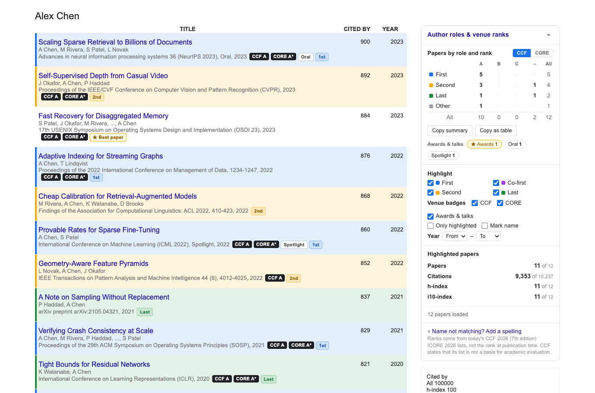

# 谷歌学术：作者位次与会议期刊等级

_English name: Scholar Author Roles & Venue Ranks_

**一眼看出每篇论文：你是第几作者、发在什么级别。** 这是一个 Chrome 扩展，读取
[Google Scholar](https://scholar.google.com) 作者主页，为每篇论文标出作者角色
（一作 / 二作 / 末位……）以及发表场所的 **CCF** 与 **CORE** 等级，并汇总成一张表：
*"一作 CCF-A 论文：4 篇"*。

[English](README.md)

<p align="center"></p>
<p align="center"><sub>虚构的作者主页（场所名称真实，论文为虚构）：按作者位次着色的行、场所旁的 CCF / CORE 徽章、右侧的角色 × 等级汇总。</sub></p>

- **角色 × 等级汇总**：页面里的一张小矩阵——一作 / 共一 / 二作 / 末位 × CCF A / B / C /
  未收录（可切换为 CORE A\* / A / B / C）。点击任一格即可只看那几篇；**复制摘要**、
  **复制为表格** 可直接粘贴进简历或申报材料。
- **每篇论文的角色着色**：整行按作者位置着色（蓝=一作，紫=共一，琥珀=二作，绿=末位），
  并带小标签；场所旁有 `CCF A`、`CORE A*` 徽章。悬停徽章可看到匹配到哪个会议/期刊、
  依据什么规则、名录版本。
- **可解释的场所匹配**：基于真实 Scholar 数据反复打磨，而不是靠猜。会议和期刊分开匹配；
  能处理被截断的名称（`…on Computer Vision and Pattern …`）、`ISCA 2014 42 (3)`、
  `[arXiv…]` 注释，以及 Findings / Workshop / Demo 等非主会议轨道。认不出的场所不会乱标，
  而是列在面板里。
- **获奖与报告形式**：论文标题或发表信息里写了 *Oral*、*Spotlight*、*Highlight* 或获奖（*Best / Outstanding /
  Distinguished Paper*、*Test of Time*），或者论文在内置的获奖名单里（ACL 系列、ICLR、NeurIPS、ICML、CVPR 2025、
  ECCV 2024，取自各会议官方获奖页），就会显示小标签（获奖为金色并带 ★）；面板里也会统计，点击即可只看那几篇。
  悬停提示会说明来自作者自述还是获奖名单。
- **补全被截断的末位作者**：Scholar 会用 `…` 截断长作者列表，导致看不到大论文里的末位作者
  （某位知名 PI 的前 100 篇里有 30 篇如此）。点 **补全** 会逐篇读取论文页（约每秒一篇，
  仅在你点击时）把角色补上。
- **指标**：高亮论文的篇数、引用、h 指数、i10；年份范围、"只显示高亮"、可选的姓名标记、
  **全部加载**。
- **隐私**：无账号、无统计、无第三方请求；名录内置在扩展里；设置通过你的 Chrome 账号同步。

适用于**作者主页**（`scholar.google.com/citations?user=…`），覆盖所有 Scholar 域名。
界面提供简体中文和英文。

## 安装

**Chrome**（Edge 等 Chromium 浏览器同理）：

1. 打开 `chrome://extensions`，开启"开发者模式"。
2. 点"加载已解压的扩展程序"，选择本仓库的 `src/` 文件夹。
3. 打开任意 Google Scholar 作者主页。

无需构建、无依赖。打包 zip（用于分享或上架）：

```bash
scripts/package-chrome.sh      # → dist/scholar-author-roles-and-venue-ranks-chrome-<version>.zip
```

## 它能知道什么、不能知道什么

- **等级是当前名录的等级，不是发表时的等级。** 2009 年发在如今是 CCF-A 的会议上的论文，
  也显示 `CCF A`。CCF 还声明其目录**不作为学术评价依据**，且会议只计 full paper——
  本扩展会排除 Findings、Workshop、Demo、Poster 等轨道，但无法从 Scholar 文本里区分
  short paper 与 full paper。
- **角色来自 Scholar 的作者文本。** 缩写做了宽松匹配（`GE Hinton` = `Geoffrey Hinton`，
  `Jane` ≠ `John`），但两个不同的人仍可能在 `W Wang` 上撞车。共一标记（†、∗ 等）存在时会
  被识别——不过 Scholar 很少保留它们。若主页姓名与论文里的写法不同，可用面板里的
  **添加一种写法**。
- **获奖名单不求完整。** 名单只覆盖上面列出的会议和各会议官方页面公布的年份；不在名单上的论文不会有获奖标签。
  报告形式（*Oral*、*Spotlight*）只来自作者自己写的文字，Scholar 的文字里很少有，`Oral Oncology` 之类也不会被标出。
- **场所字符串很乱。** Scholar 显示的内容可由主页所有者编辑，且常被截断。认不出的会列在
  "发表场所未收录"里供你查看；不做模糊猜测。
- **补全** 会访问 Google Scholar（论文自己的页面，同源、限速、缓存）。大量使用后 Google
  可能弹出验证码；扩展一遇到就会停下并提示。
- 不支持搜索结果页：那里既没有主页所有者，也没有完整的场所名称。

## 数据

| 数据集 | 版本 | 来源 |
|---|---|---|
| CCF 推荐国际学术会议和期刊目录 | 2026（第七版），386 个会议 + 295 个期刊 | [ccf.org.cn](https://www.ccf.org.cn/Academic_Evaluation/By_category/) 的 PDF，可复现地抽取——见 [`data/README.md`](data/README.md) |
| CORE 会议等级 | ICORE 2026，800 个已评级会议 | [portal.core.edu.au](https://portal.core.edu.au/conf-ranks/) 导出 |

两份数据仅作参考收录，版权归各自所有者——见 [`NOTICE`](NOTICE)。用 `npm run data` 重新生成。

## 开发

```bash
npm test            # 单元测试：姓名、场所（真实主页语料）、指标、包结构
npm run test:e2e    # 把扩展装进 Chromium，对本地的 Scholar 仿页做端到端测试
npm run data        # 由 data/*.json 重建 src/data/*.js
```

架构与匹配规则见 [`docs/ARCHITECTURE.md`](docs/ARCHITECTURE.md)。Chrome 是主线；Safari 仅为尽力而为
（[`contrib/safari`](contrib/safari/README.md)）。

## 许可

[Apache License 2.0](LICENSE)。名录数据不在此许可范围内——见 [`NOTICE`](NOTICE)。
