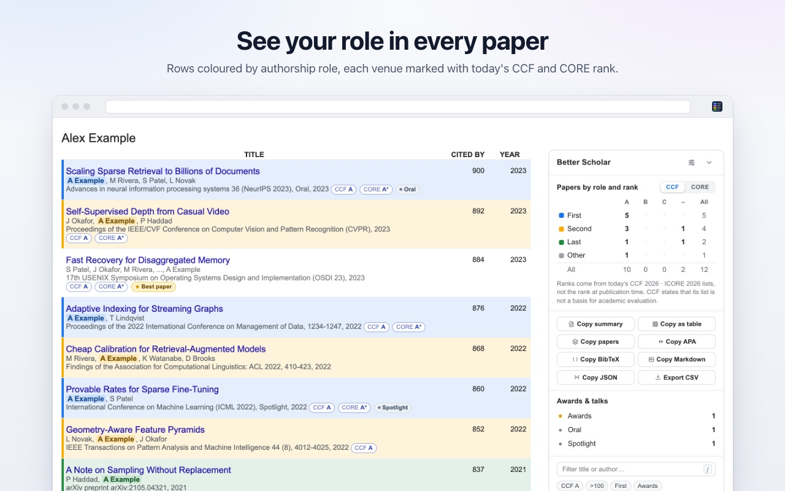
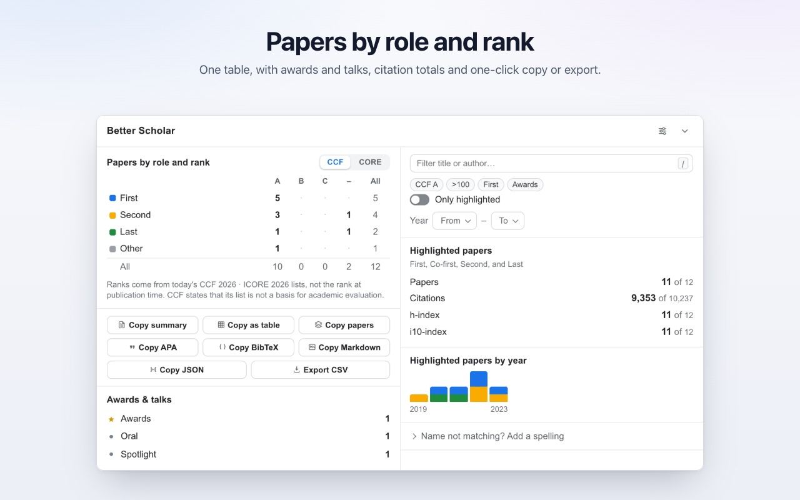
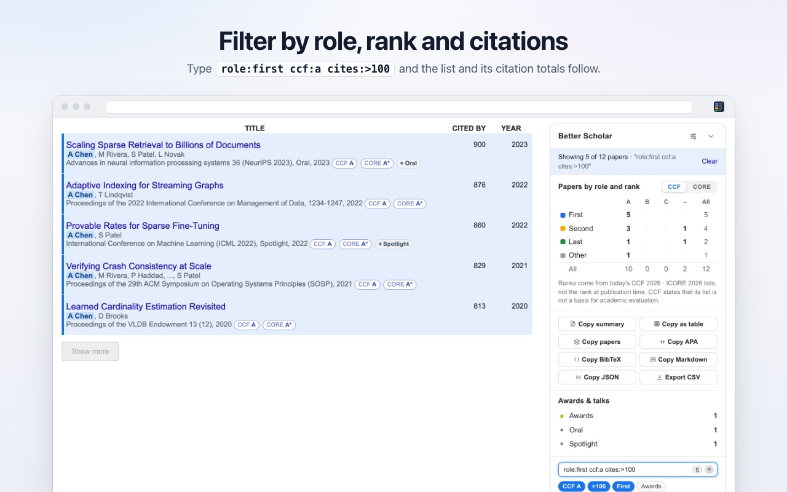
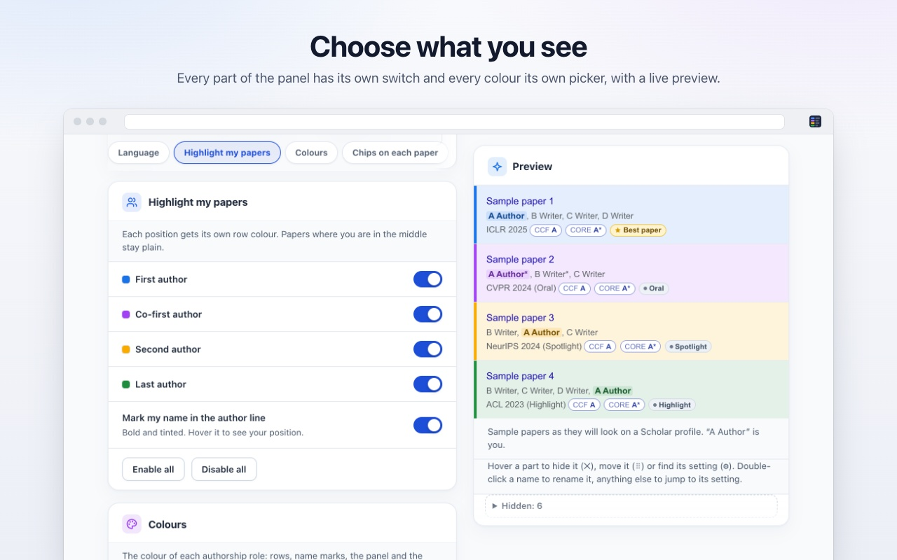
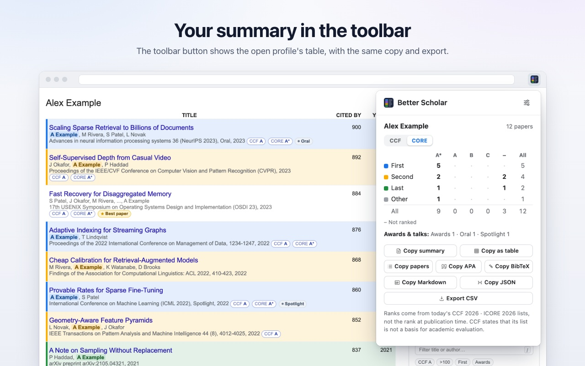
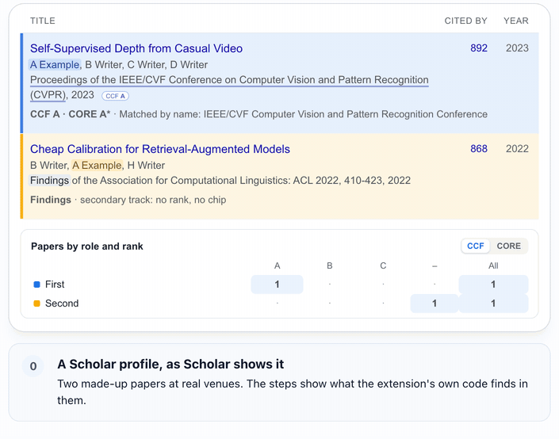
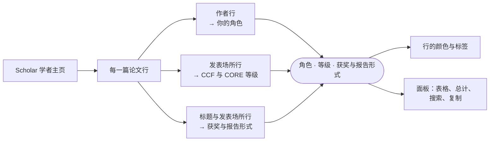
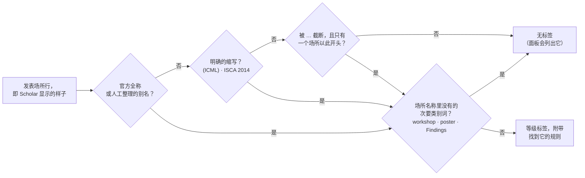
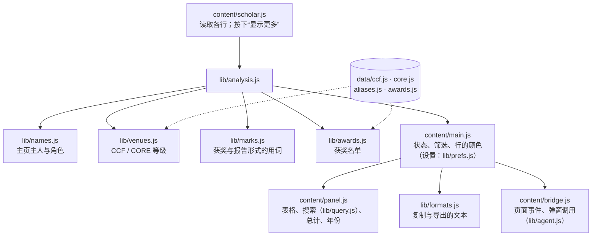

<div align="center">


# Better Scholar

**在谷歌学术学者主页的每篇论文上，显示你的作者角色与发表场所等级。**

[](LICENSE)
[](https://github.com/boyugou/better-scholar)
[](https://github.com/boyugou/better-scholar/actions)
[](package.json)
[](src/_locales)
[](PRIVACY.md)

[官方网站（30 种语言）](https://boyugou.github.io/better-scholar/) · [English](README.md) · [安装使用](#安装使用) · [工作原理](#工作原理) · [核心功能](#核心功能) · [搜索](#搜索运算符) · [复制与导出](#复制与导出) · [面向 AI 智能体](#面向-ai-智能体) · [隐私政策](PRIVACY.md)

<br>



</div>

## 功能概览

Better Scholar 是一款免费的 Chrome 扩展，用于 [Google Scholar](https://scholar.google.com) 学者主页。它为每篇论文添加三项内容：

| 每篇论文上 | 你会看到什么 |
|---|---|
| **你的角色**：你在作者行中的位置 | 这一行按角色着色：一作、共一、二作或末位作者。 |
| **发表场所等级**：来自 CCF（2026 第七版）和 CORE（ICORE 2026）名录 | 发表场所旁的标签：`CCF A`、`CORE A*`。 |
| **获奖与报告形式**：来自官方获奖页面，以及作者自己写的文字 | 一个标签：`★ Best paper`、`Oral`、`Spotlight`、`Highlight`。 |

列表旁的面板按角色和等级统计你的论文。它还显示引用总数和按年份的论文数，并提供搜索框和复制按钮。

- **不猜测。** 名录不能确定的发表场所不给标签，面板会将其列出。每个标签的悬停提示都写明发表场所、找到它所依据的规则，以及名录的版本。
- **注重隐私。** 无需账号，没有分析统计，也没有追踪。所有处理都在你的浏览器中完成。除 Scholar 外，唯一会发出的请求是 Semantic Scholar 查询，默认关闭。
- **开源且简单。** 以 Apache 2.0 协议开源，没有依赖，也没有构建步骤。

<details>
<summary>更多截图：面板、搜索、设置页、工具栏弹窗</summary>
<br>
<table>
  <tr>
    <td align="center" width="50%"></td>
    <td align="center" width="50%">100 搜索，列表与总计随之收窄" width="460"></td>
  </tr>
  <tr>
    <td align="center"><sub>面板：角色 × 等级表、复制与导出、获奖与报告形式、筛选</sub></td>
    <td align="center"><sub>搜索：<code>role:first ccf:a cites:&gt;100</code>，列表与总计随之收窄</sub></td>
  </tr>
  <tr>
    <td align="center" width="50%"></td>
    <td align="center" width="50%"></td>
  </tr>
  <tr>
    <td align="center"><sub>设置：每个部分一个开关，以及实时预览</sub></td>
    <td align="center"><sub>工具栏弹窗：表格，以及复制与导出按钮</sub></td>
  </tr>
</table>
</details>

## 安装使用

1. 下载本仓库（**Code → Download ZIP**）并解压，或者克隆它。
2. 打开 `chrome://extensions`。
3. 打开右上角的 **开发者模式**（Developer mode）。
4. 点击 **加载已解压的扩展程序**（Load unpacked），然后选择 [`src/`](src/) 文件夹。
5. 打开一个 Google Scholar 学者主页（`scholar.google.com/citations?user=…`）。

Edge、Brave、Arc、Opera 等 Chromium 内核浏览器使用同样的步骤。Safari 的支持尽力而为，见 [`contrib/safari/`](contrib/safari/README.md)。

> [!TIP]
> 更新（`git pull`）之后，在 `chrome://extensions` 中点击 Better Scholar 卡片上的刷新图标，然后刷新已打开的 Scholar 标签页。

## 工作原理

扩展读取主页论文列表中的每一行。每一行做三次查找，然后为该行上色、添加标签，并填入面板。

<p align="center"></p>

<p align="center"><sub>两篇虚构的论文，发表在真实的场所，由扩展自身的代码读取。同样的步骤也在 <a href="https://boyugou.github.io/better-scholar/">官方网站</a> 上展示，网站有 30 种语言。</sub></p>

每篇论文都会经过以下全部步骤：



### 你的角色

扩展在每一条作者行中找到主页的名字。你在这一行中的位置决定你的角色：

| 角色 | 何时 |
|---|---|
| 一作 | 你是第一作者。 |
| 共一 | 你位于开头的一组作者之中。这一组至少两人，且共享同一个标记，例如 `*` 或 `†`：`A*, B*, C`。 |
| 二作 | 你是第二作者。 |
| 末位 | 你是末位作者，且作者列表完整。在两位作者的论文中，第二作者同时也是末位作者。 |
| 其他 | 其他任何位置。这一行保持原样。 |

- **首字母缩写也能匹配。** Scholar 显示的是 `GE Hinton`，即 Geoffrey Hinton。扩展能识别出来。
- **被截断的作者列表。** Scholar 用“…”截断长的作者列表。如果截断遮住了你的位置，你的角色也会被隐藏。点击面板中的 **补全**。扩展随后读取每篇此类论文在 Scholar 上的页面（约每秒一篇，且只在你点击之后），找出角色。若你允许，它会先询问 Semantic Scholar。
- **同一行里有两个“你”。** 一条作者行中，你的名字写法可能出现两次（`X Wang, X Wang, P Cong`）。如果两处给出的角色不同，这一行无法判断哪一处是你。此时这篇论文计为 *其他*，绝不会计为一作、二作或末位作者。在 5,000 条真实作者行上，以 OpenAlex 的作者位置为准，这条规则去掉了所有错误的一作、二作和末位判定。
- **其他写法。** 扩展还会尝试你姓名的另一种语序（`Tang Jie` 对应 Jie Tang），但只在主页自己的论文行显示出这种语序时才这样做。它也会建议在你论文中找到的其他写法。每个主页最多可以添加八种写法（**名字没匹配上？添加一种写法**）。

### 发表场所等级

查找会对 CCF 名录和 CORE 名录各做一次。它不使用模糊匹配，也不使用子串匹配：



真实示例。测试会将每一行与代码对照检查：

<!-- examples:begin -->
| Scholar 显示的文字 | 标签 | 依据 |
|---|---|---|
| `Proceedings of the IEEE/CVF Conference on Computer Vision and Pattern Recognition (CVPR), 2023` | CCF A · CORE A* | `name` |
| `ISCA 2014 42 (3), 361-372, 2014` | CCF A · CORE A* | `acronym` |
| `Proceedings of the 2026 CHI Conference on Human Factors in …, 2026` | CCF A · CORE A* | `prefix` |
| `IEEE Transactions on Pattern Analysis and Machine Intelligence 44 (8), 4012-4025, 2022` | CCF A | `name` |
| `NeurIPS 2023 Workshop on Instruction Tuning and Instruction Following, 2023` | — | 次要类别词 `workshop` |
| `Findings of the Association for Computational Linguistics: ACL 2022, 410-423, 2022` | — | 次要类别词 `Findings` |
| `arXiv preprint arXiv:2105.04321, 2021` | — | — |
<!-- examples:end -->

- **会议与期刊分属两份名录。** 发表场所行中的用词决定查哪一份名录。CORE 只给会议排等级。
- **次要类别词。** Findings、workshop、demo、poster、tutorial、扩展摘要、短文、工业论文和共享任务都不是主会。它们不给标签，除非这个词本身是场所官方名称的一部分。
- **一个标签，而非两个。** CCF 与 CORE 大多给相同的场所排等级。因此默认情况下，一篇论文只显示 CCF 标签；只有 CCF 没有该场所的等级时，才显示 CORE 标签。CCF 标签的悬停提示也会写出 CORE 等级。**CORE 优先** 和 **两者都显示** 可以改变这一点。“常见发表场所”列表，以及 Markdown 和 BibTeX 复制内容中的注释，都跟随这一选择。表格、搜索和其他复制格式则始终保留两个名录。
- **两份名录互相关联。** 两份名录常用两种名称指同一个场所（*ACM SIGCHI Conference on Designing Interactive Systems* 和 *Designing Interactive Systems*）。扩展知道这些配对。一份名录里匹配上的场所，另一份名录中同一场所的那一行也会一并给出。
- **当前等级。** 等级取自当前的名录，而不是论文发表那一年的名录。面板和每条提示都会说明这一点。

### 获奖与报告形式

- **获奖名单。** 扩展收录了 7,830 项取自官方页面的论文奖项：最佳论文、最佳学生论文、杰出论文与卓越论文、荣誉提名，以及时间检验奖。来源包括 ACL Anthology 的获奖数据、计算机视觉基金会（CVF），以及各会议和学会的获奖页面（NeurIPS、ICML、ICLR、CVPR、ICCV、ECCV、ACL、EMNLP、NAACL、AAAI、IJCAI、SIGCOMM、S&P、CCS、USENIX Security、SIGMOD、VLDB、OSDI、SOSP、CHI 等）。只有标题完全相同，并且获奖记录的第一作者是该论文的作者之一，论文才与该奖项匹配。
- **作者自己写的文字。** 扩展从标题或发表场所行中读出获奖用语（Best Paper、Outstanding Paper、Test of Time、最佳论文入围），以及报告形式 Oral、Spotlight 和 Highlight。它的规则不处理普通词：*Oral Oncology* 是一份期刊。

## 核心功能

### 面板

- **角色 × 等级表**，分 CCF 与 CORE 两种。点击一个单元格、一个角色或一个等级，即可列出对应的论文。
- **复制行**：每开启一种格式，就有一个对应的按钮。见 [复制与导出](#复制与导出)。
- **获奖与报告形式**：各项计数。点击一个计数，即可列出它的论文。
- **搜索与筛选**：普通词与[运算符](#搜索运算符)；快速筛选按钮，如 *CCF A*、*>100*、*一作*、*获奖* 和 *近 5 年*；*只显示高亮*；以及年份范围。表格、获奖与报告形式的计数，以及复制的摘要，只统计筛选后剩下的论文。（设置页中的一个开关可以关闭这一点。）
- **引用统计**：高亮论文的论文数、引用数、h 指数和 i10 指数，与全部论文的合计并列显示。**h 指数** 和 **i10 指数** 按钮可列出构成该数字的论文。
- **按年份统计**：每年一根柱（最多 50 年），颜色取自各角色。点击一根柱，即可筛选到那一年。
- **常见发表场所**（默认关闭）：高亮论文所在的有等级场所，按论文数从多到少排列。点击一个场所，即可列出它的论文。
- **状态行**：已加载的论文数；作者列表被截断而隐藏的角色（**补全**）；与其他论文重复的条目；没有等级的发表场所的论文，附 **复制列表**、**反馈**，以及每个场所后的 **核对** 链接。
- **完整的列表。** Scholar 起初只显示主页的前几篇论文。按下它自己的 **显示更多**（Show more）按钮后，才会显示更多。扩展默认替你按这个按钮，直到列表完整：每次只按一下，约每秒一次，且只在你正在看的标签页中进行。第一次按下后若没有新论文，它就停止。关闭 **自动加载全部论文** 后，面板会显示 **全部加载** 按钮。
- 面板顶部的横条显示筛选后可见的论文数，并可一键清除筛选。在页面上按 `Escape` 也会清除所有筛选。
- **工具栏弹窗**：当前标签页中主页的表格、获奖与报告形式的计数，以及复制按钮。

### 设置页

所有设置都在一个页面上。修改会立即保存，已打开的 Scholar 标签页随之重绘。

- **预览就是真正的面板**，显示在示例论文行之上，而且可以编辑。将鼠标指向预览中的某一部分，即可隐藏（✕）、移动（⠿）、重命名（✎），或找到它的设置（⚙）。双击名称即可重命名，双击其他任何内容则跳到对应的设置。左侧的卡片从上到下与预览的顺序一致。
- **每样东西都有一个开关。** 面板的每个部分，以及部分中的每样东西（标题、列、按钮、快速筛选、数字），都有各自的开关。开关决定是否显示。显示什么，就搜索什么、复制什么。
- **顺序。** 在预览上拖动面板的各部分、复制按钮和快速筛选，或使用左侧的按钮，即可调整顺序。
- **你自己的名称。** 标题、列名、按钮和标签文字都可以改成你自己的叫法。自定义名称会替换所有语言中的译文。导出内容、搜索运算符和页面调用仍使用标准用词。
- **颜色。** 五套配色主题，或为每种角色单独设色。每种角色颜色都会显示它与 Scholar 白色页面的对比度；低于 3:1（WCAG 对图形的最低要求）时会给出警告。
- **标签外观。** 描边、柔和、实心或仅文字；圆角或直角；标签上显示名录与等级（CCF A），或只显示等级（A）；CCF、CORE、获奖和报告各有一种颜色；另有六套现成外观。
- **核对期刊/会议**：粘贴 Scholar 显示的发表场所文字。页面会显示 CCF 和 CORE 等级、它匹配到的名称和所依据的规则。若是 CCF 场所，还会显示研究领域和它在 DBLP 上的页面链接。没有等级时，页面会说明原因。
- **配置与预设**：预设 *全功能开启*、*末位作者偏好*、*第一作者偏好* 和 *极简风格*；以 JSON 复制、导出、导入或编辑配置。
- 卡片上方的搜索框可以筛选设置。按 `/` 跳到搜索框（一个开关可以关闭这个键）。

<details>
<summary>设置页的卡片，按预览中的顺序排列</summary>

| 卡片 | 内容 |
|---|---|
| 语言 | 扩展的语言（或跟随浏览器）；*以此语言打开 Scholar* |
| 高亮我的论文 | 每种角色一个开关；*在作者行里标出我的名字* |
| 颜色 | 五套配色主题（默认、冷色、暖色、高对比度、柔和）；每种角色一个颜色，并附对比度标记；行的高亮样式：底色加色条、只要色条、只要底色、不上色 |
| 每篇论文上的标签 | CCF、CORE、获奖和报告的标签；两个名录都给场所排等级时，显示哪一个名录的标签（CCF 优先、CORE 优先、两者都显示）；获奖标签的名称；标签的外观 |
| 摘要面板 | 面板本身；各部分的顺序；标题栏的各部分；提示列表已被筛选的横条；*精简* |
| 角色 × 等级表、复制与导出、获奖与报告形式、筛选、引用统计、按年份统计、常见发表场所、已加载论文与未收录的发表场所、名字拼写帮助 | 面板每个部分一张卡片：它的开关；其中每样东西的开关（以及名称）；有顺序的部分还有顺序 |
| Scholar 自带的区块 | 隐藏 *被引用次数*（或只隐藏其表格或图表）、*合著者*、*公开访问* |
| 重复条目 | *合并重复论文* |
| 论文列表 | *自动加载全部论文* |
| Semantic Scholar | *优先用 Semantic Scholar 补全作者列表*（默认关闭）；可选的 API 密钥 |
| 核对期刊/会议 | 一个文本框，用来粘贴发表场所文字，并显示名录对它的判定 |
| AI 智能体 | *复制智能体指南* |
| 配置与预设 | 预设；*复制配置 (JSON)*、*导出文件*、*导入文件*；一个 JSON 编辑器 |
| 已保存的数据 | *查看已保存详情*、*清除已保存的论文详情*、*恢复默认设置*、*复制问题报告所需的信息* |

- **配置是 JSON。** 编辑器和 *导入文件* 接受与导出记录结构相同的补丁，例如 `{ "panel": { "years": { "show": false }, "copy": { "order": ["bibtex", "summary"] } }, "rows": { "style": "bar" }, "labels": { "metricsTitle": "My papers" } }`。页面会说明应用了什么、忽略了什么以及原因。预设只改动它列出的设置。没有任何预设会开启 Semantic Scholar。
- **旧版本的设置不做迁移。** 存储的记录逐项读取。名称和类型仍与某项设置相符的值会被保留，其他一律使用默认值。
- Chrome 对同步设置每分钟只接受 120 次写入。设置页最多每分钟写入约 100 次，并会在 Chrome 拒绝写入时给出提示。

</details>

### 界面语言

扩展支持 30 种语言：English、简体中文、繁體中文、日本語、한국어、Español、Français、Deutsch、Italiano、Português (Brasil)、Português (Portugal)、Русский、Українська、Polski、Čeština、Nederlands、Svenska、Dansk、Suomi、Norsk、Türkçe、العربية、עברית、हिन्दी、Bahasa Indonesia、Tiếng Việt、ไทย、Ελληνικά、Magyar 和 Română。除非你自己选择，否则跟随浏览器的语言。*以此语言打开 Scholar* 会通过 Scholar 的 `hl=` 设置，用你选的语言打开 Scholar 自身的页面（`/scholar`、`/citations`）。

## 搜索运算符

在学者主页上按 `/`，即可跳到搜索框。（面板及其筛选部分必须显示。设置页中的一个开关可以关闭这个键。）论文必须同时匹配每一个普通词和每一个运算符。普通词会在标题、作者、发表场所、该场所在名录中的名称、年份、角色和获奖标记中查找。不区分大小写。

| 运算符 | 示例 | 匹配 |
|---|---|---|
| `cites:` | `cites:>100`、`cites:>=50`、`cites:<10`、`cites:25` | 引用数，与一个数字比较：`>` `>=` `<` `<=` `=`。只写数字即表示 `=`。 |
| `year:` | `year:>=2020`、`year:<2015`、`year:2023` | 发表年份，比较方式相同。 |
| `age:` | `age:<5`、`age:<=10`、`age:0` | 论文发表至今的年数。今年为 0，所以 `age:<5` 即最近五年，并且随年份推移始终成立。 |
| `ccf:` | `ccf:a`、`ccf:b`、`ccf:c` | 场所的 CCF 等级。 |
| `core:` | `core:a*`、`core:a`、`core:b`、`core:c` | 场所的 CORE 等级。 |
| `role:` | `role:first`、`role:cofirst`、`role:second`、`role:last`、`role:middle` | 你在作者列表中的位置。`middle` 指不属于其他四种的位置。 |
| `type:` | `type:conference`、`type:journal` | 名录所记的场所类型。没有等级的场所没有类型。 |
| `has:` | `has:award`、`has:talk` | 最佳论文奖或最佳论文入围标记；Oral、Spotlight 或 Highlight 标记。 |
| 普通词 | `ccf:a role:first cites:>100 detection` | 所有条件组合使用：每个条件都必须匹配。 |

- **逗号表示“或”。** `role:first,last` 表示一作或末位作者。`ccf:a,b` 表示 CCF A 或 B 类场所。用空格分开的各个词必须全部匹配。同一运算符的两个快捷按钮会合并成一个词：*一作* 和 *末位* 合成 `role:first,last`。
- **错误。** 运算符取了它不接受的值（如 `ccf:x`）时，不匹配任何论文。搜索框会被标出，其提示会说明原因。冒号前不是运算符的词（如 `http://…`）按普通词处理。
- **建议。** 输入运算符的冒号（如 `role:`），即可看到它的取值。按 `↓` 或点击 `/` 提示，可以看到常用搜索。用 `↑` 和 `↓` 选择，`Enter` 或 `Tab` 采用所选项。没有列表时，`Enter` 跳到下一条匹配的行，`Shift`+`Enter` 跳到上一条。
- `Escape` 先关闭列表，再清空搜索框。在页面上，`Escape` 会清除所有筛选。
- 搜索框下方的快速筛选按钮是 `ccf:a`、`cites:>100`、`role:first` 和 `has:award`。设置中还能添加：`core:a*`、`age:<5`（*近 5 年*）、`role:cofirst`、`role:second`、`role:last` 和 `has:talk`。页面上没有任何东西显示某类论文时，对应的按钮会被略去。
- 搜索框最多接受 500 个字符。

### 常见用法

| 我想要… | 怎么做 | 得到的结果 |
|---|---|---|
| 最近五年的表格 | 按 *近 5 年*（在 *设置 → 筛选* 中打开它），或输入 `age:<5` | 表格、获奖与报告形式的计数和 *复制摘要*，只统计这些论文。复制的文字会说明这一点。 |
| CCF A 或 B 类场所上的一作或末位论文 | `role:first,last ccf:a,b` | 这些论文。表格会统计它们，单元格如 *末位 × A* 会列出其中的论文。 |
| 最近十年的获奖论文 | `has:award age:<10` | 这些论文，以及它们在表格中的计数。 |
| 引用超过 100 次、发表于有等级期刊的论文 | `type:journal cites:>100` | 这份列表，以及其中高亮论文的引用总数。 |
| 与某位合著者合作的论文 | 先按一次 *补全*，再输入其姓氏 | 作者列表中任何位置出现该姓名的每一篇论文。 |
| 可能不属于本人的论文 | 点击状态行中的“N 篇的作者列表里没找到本人姓名” | 这些论文，供核对或反馈。 |
| 要归档或发送的摘要 | *复制摘要* 或 *复制为表格* | 文字形式的表格（在 Word 中则是真正的表格）、名录版本、统计了什么，以及一行写有主页链接和日期的文字。 |

## 复制与导出

每种格式在面板的复制行和工具栏弹窗中各有一个按钮。在 *设置 → 复制与导出* 下，每种格式各有自己的开关（默认全部开启）。

- 论文类格式取页面当前显示的论文，即筛选之后的结果。它们使用 *补全* 保存的完整作者列表。
- 摘要和表格统计筛选后剩下的论文（在面板中；弹窗统计所有已加载的论文）。它们会说明统计了什么，例如：“显示 25 / 100 篇论文 · 2021–…”。
- 它们还会附加一行，写明主页链接和日期（`Source: …`；由 *复制与导出* 卡片上的一个开关控制）。列表未全部加载时，它们会说明这一点。

| 按钮 | 输出 |
|---|---|
| *复制摘要* | 纯文本的角色 × 等级表，附“未收录”列所含内容、获奖与报告形式一行，以及名录版本 |
| *复制为表格* | 角色 × 等级表，以制表符分隔，便于粘贴进电子表格；同时附带一份真正的表格，供文字处理软件粘贴 |
| *复制论文列表* | 论文列表，以制表符分隔：年份、标题、作者、角色、场所、CCF、CORE、获奖与报告形式、引用数（表头使用界面语言）。同时附带一份真正的表格，供文字处理软件粘贴，其中你的名字为粗体。 |
| *复制 APA* | APA 第 7 版参考文献：`Authors (Year). Title. *Venue*. URL`。同时附带真正的斜体，供文字处理软件粘贴。 |
| *复制 BibTeX* | BibTeX 条目 |
| *复制 Markdown* | 带编号的 Markdown 列表：带链接的标题、作者、场所与年份、等级、获奖、引用数 |
| *复制 JSON* | `{ owner, source, total, papers }`：每篇论文一条记录，含其角色、等级和获奖与报告形式 |
| *导出 CSV* | 论文表格导出为文件：`<profile name>-papers.csv` |

<details>
<summary>各格式的规则</summary>

- **BibTeX。** 引用键由第一作者的姓、年份，以及标题中第一个至少三个字母、且不是常见词（如 `the`、`for`、`with`、`towards` …）的单词组成，全部为小写 ASCII：`vaswani2017attention`、`he2016deep`。没有年份时，引用键为 `nodate`。重复的引用键依次加上 `b`、`c` 等（`he2016deepb`）。条目类型按名录或场所名称中的用词，定为 `@inproceedings`（booktitle）或 `@article`（journal），否则为 `@misc`。字段包括：title、author（用 `and` 连接；在 Scholar 截断列表处以 `and others` 结尾）、booktitle 或 journal、year、url（论文在 Scholar 上的页面），以及一条 note，写明 CCF 与 CORE 等级和获奖情况。TeX 会解读的每个字符（`\ { } $ & # ^ _ ~ %`）都会被转义，因此标题不能夹带命令。
- **APA 第 7 版。** `I Stoica` → `Stoica, I.`；`MF Kaashoek` → `Kaashoek, M. F.`；`L van der Maaten` → `van der Maaten, L.`。两位作者之间用 `&` 连接。超过 20 位作者时，列出前 19 位、`…` 和最后一位。被截断的列表以 `…` 结尾。没有年份时写 `(n.d.)`。星号标出斜体部分。
- **Markdown。** Markdown 会解读的每个字符都会被转义，因此标题不会变成链接或标记。
- **CSV。** 遵循 RFC 4180，带 UTF-8 字节序标记（让 Excel 能正确读取非拉丁文字），行尾为 CRLF。含有逗号、引号、分号或换行的字段会加上引号。
- **Word、Google Docs、Pages。** 表格、论文列表和 APA 三个按钮在文本之外，还会把 HTML 放入剪贴板。文字处理软件粘贴时，会得到真正的表格（带边框），或带真正斜体、链接和悬挂缩进的参考文献列表。电子表格和文本框则取文本。HTML 中的所有文字都经过转义。看起来像公式的单元格会被当作文本，与制表符格式的处理方式相同。其他格式只有文本。工具栏弹窗和 `export` 调用（`html: true`）给出相同的结果。
- **电子表格公式。** 在 CSV 和制表符分隔的格式中，以 `=`、`+`、`-` 或 `@` 开头（且不是纯数字）的单元格前会加一个撇号。电子表格随后将它显示为文本。
- 筛选后没有论文时，不复制任何内容，按钮会显示 *没有可复制的内容*。

</details>

## 面向 AI 智能体

### 通过 AI 助手设置

*设置 → AI 智能体 → 复制智能体指南* 会把一份 Markdown 指南放入剪贴板。指南包含每项设置（路径、取值、默认值和作用）、你当前的设置、预设、页面调用和搜索语法。指南由代码自身运行所用的同一批表格生成（`lib/prefs.js` 中的 `SETTINGS` 和 `PRESETS`、`lib/agent.js` 中的 `METHODS`、`lib/query.js` 中的 `OPERATORS`），因此不会与代码脱节。

1. 把指南交给你的 AI 助手，并说明你想要什么。
2. 把它的回答（一个 JSON 对象）粘贴到 *配置与预设 → 粘贴或编辑配置 (JSON)* 中。
3. 点击 *应用配置*。

### 页面事件

在学者主页上，扩展运行时会在 `<html>` 上设置属性 `data-rr-ready="true"`。它监听 `document` 上的 `better-scholar:request` 事件，并以 `better-scholar:response` 事件作答：

```javascript
const id = crypto.randomUUID();
const answer = new Promise((resolve) => {
  const on = (e) => { if (e.detail.id === id) { document.removeEventListener("better-scholar:response", on); resolve(e.detail); } };
  document.addEventListener("better-scholar:response", on);
});
document.dispatchEvent(new CustomEvent("better-scholar:request", { detail: { id, method: "export", params: { format: "bibtex" } } }));
const { ok, result, error } = await answer;   // result.text is the BibTeX
```

请求的 `detail` 为 `{ id, method, params }`。`id` 若是字符串或数字，原样返回；其他类型的 `id` 会返回 `null`。回答为 `{ id, ok: true, result }` 或 `{ id, ok: false, error }`。

| 调用 | 参数 | 结果 |
|---|---|---|
| `ping` | 无 | `{ version, owner, loaded, complete }` |
| `summary` | `filtered`（`true`：表格和获奖与报告形式的计数只统计筛选后剩下的论文，与面板的统计方式相同；默认 `false`：所有已加载的论文） | 角色 × 等级表（CCF、CORE，以及仅按角色）、获奖与报告形式的计数、引用统计，以及 `counted`（表格统计了多少篇论文） |
| `papers` | `filtered`（默认 `true`：页面当前显示的论文；`false`：所有已加载的论文） | `{ owner, total, papers: [{ id, title, authors, me, venue, year, citations, role, status, highlighted, type, rank, marks, url }] }` |
| `export` | `format`（必填：`summary`、`table`、`papers`、`apa`、`bibtex`、`markdown`、`json`、`csv`）；`source`（`ccf`、`core`、`none`；用于摘要和表格）；`html`（`true`：对 `table`、`papers` 和 `apa` 另外返回 `html`）；`filtered`（`true`：摘要和表格只统计筛选后剩下的论文） | `{ format, text, html? }` |
| `filter` | `query`、`onlyHighlighted`、`yearStart`、`yearEnd`、`minCitations`、`impact`（`h` 或 `i10`）；`null` 清除一个数值 | `{ shown, total, filters, errors, ignored }`（`ignored`：因设置中没有对应控件而被忽略的筛选） |
| `clearFilters` | 无 | `{ shown, total, filters, errors }` |

- 参数在执行前先被检查。参数有误时，返回 `ok: false` 及原因。面板关闭时，`filter` 会被拒绝，因为页面上没有任何东西能撤销它。
- 这些调用读取面板显示的内容，并设置页面的筛选。它们不能读取或修改设置，也不发出任何网络请求。页面上的任何脚本都能发出这些调用：见 [`SECURITY.md`](SECURITY.md)。
- 工具栏弹窗通过扩展自身的消息（`{ type: "rr:call", method, params }`）发出同样的调用。网页和其他扩展无法访问这些消息。

## 数字一览

扩展由什么构成，从它的代码和数据中统计。这里没有任何内容是手工输入的（`npm run numbers`）：

<!-- numbers:begin -->
| 数字 | 含义 | 统计自 |
|---:|---|---|
| **154** | 项可调整的设置，分布在 18 张卡片中：87 个开关、48 处可自定义名称，以及 19 项颜色、选项、顺序和语言 | 设置树的各行（`src/lib/prefs.js`） |
| **172** | 个节点，共 5 层：卡片、某个部分的开关、其中的一项、它的名字 | 卡片和各行；每一行挂在所属部分的开关下 |
| **9 · 8 · 10 · 6 · 4** | 个面板部分、复制格式和快捷筛选——每一项都有自己的开关，多数还能排顺序——以及可选的标签样式和预设 | `SECTIONS`、`COPY_BUTTONS`、`PILLS`、`CHIP_THEMES`、`PRESETS` |
| **30** | 种界面语言——每种 353 条文案，29 种译文 | `src/_locales/*/messages.json` |
| **1,178** | 个有等级的发表场所，来自两份内置名录的 1,481 行（CCF 会议 386、CCF 期刊 295、CORE 会议 800）；其中 299 个在两份名录中各有一行 | `src/data/ccf.js` 和 `src/data/core.js` 的各行，由 `idx.partners` 关联 |
| **400+** | 个 Scholar 显示但名录中没有的场所名称，收录在 250+ 条人工整理的条目中：旧名与改名、其他拼写、名录自身的笔误，以及不给标签的同名活动 | `src/data/aliases.js` |
| **2,500+** · **1,100+** | 个名称写法和缩写，匹配器逐一查找 | 各索引的键 |
| **50+** | 个两份名录叫法不同、但匹配器知道是同一场所的发表场所：一份名录匹配上，另一份名录的等级也一并给出 | `idx.partners` |
| **5 · 18** | 道识别步骤（全名、期刊词袋、缩写、被截断名称的可见开头、全名加副标题）和防止较弱判断压过较强判断的防护 | `src/lib/venues.js` 中标注的步骤与 `docs/ARCHITECTURE.md` 的检查表 |
| **5,581** | 篇获奖论文，另有 2,143 篇获荣誉提名或亚军（共 7,830 项奖项），来自 194 个会议和系列，1990–2026 年 | `src/data/awards.js` |
| **22,744** | 行真实的 Scholar 发表场所文本，每一行的结果都逐一核对并记录 | `test/fixtures/venues.expected.json` |
| **500+ · 90+ · 15** | 个单元测试、在加载了扩展的真实 Chromium 里运行的端到端检查、网页演示的检查 | `test/*.test.js`、`test/e2e/` |
| **0** | 个依赖，也没有构建步骤 | `package.json` |

这些数字由 `npm run numbers` 从代码和数据里统计，并有测试保证与实际一致；随每次修复增长的数目只写成向下取整的“N+”。
<!-- numbers:end -->

## 数据来源

| 数据集 | 版本 | 范围 | 来源 |
|---|---|---|---|
| **CCF 推荐目录** | 2026（第七版） | 会议和期刊，A、B、C 三级 | [ccf.org.cn](https://www.ccf.org.cn/Academic_Evaluation/By_category/)，从官方 PDF 中可复现地抽取 |
| **CORE 会议等级** | ICORE 2026 | 会议，等级为 A*、A、B 和 C | [portal.core.edu.au](https://portal.core.edu.au/conf-ranks/)，官方导出 |
| **论文奖项** | 2026-10，人工整理 | 最佳论文及其他论文奖项 | 官方获奖页面：[ACL Anthology](https://aclanthology.org)、计算机视觉基金会（CVF），以及各会议及其学会（ACM 各 SIG、IEEE 各技术委员会 …）。每一条都保留其页面和一段引文。 |

等级取自当前的名录，而不是论文发表时该场所的等级。每周一，一个 GitHub 工作流会检查内置的 CCF 和 ICORE 文件，是否仍与官方发布的内容一致（`.github/workflows/data-fresh.yml`）。这些排名名录归其制作方所有，收录于此仅供参考：见 [`NOTICE`](NOTICE)。

## 开发与测试

单元测试在 Node.js 20 或更高版本上运行，无需任何依赖。端到端检查和审查需要 Playwright 与一个 Chromium 构建版本。

```bash
npm test                              # the unit tests
npm run test:e2e                      # the end-to-end checks: the real extension in Chromium, on a local Scholar stand-in
npm run test:update                   # rewrite the venue snapshot (review its diff first)
npm run data                          # rebuild src/data/{ccf,core,awards}.js from data/*.json
npm run check:profile -- page.html    # the extension on a real saved Scholar profile page
node scripts/axe-audit.mjs            # accessibility audit with axe-core
scripts/package-chrome.sh             # check the bundled data, then write dist/better-scholar-chrome-<version>.zip
```

<details>
<summary>代码如何组织</summary>



`src/lib/` 中的代码全部是纯的：不碰 DOM，也不使用 `chrome.*`。在扩展中，每个文件都挂到 `globalThis.RolesRanks` 上。在 Node 下则用 `require` 加载，因此单元测试无需构建步骤即可运行真实代码。设置页和工具栏弹窗是独立的页面；弹窗会向主页标签页索取数字。细节见 [`docs/ARCHITECTURE.md`](docs/ARCHITECTURE.md)。

</details>

<details>
<summary>无障碍检查</summary>

下面是检查的内容与方式。这并不声明符合任何 WCAG 等级。

- `node scripts/axe-audit.mjs` 用 axe-core 4.10 的默认规则，在本地的 Scholar 仿真页面上检查面板，并检查设置页和工具栏弹窗。检查覆盖浅色和深色模式、筛选后的列表、所有部分全部开启、窄窗口布局，以及用户会停留的各种设置页状态（某个部分被悬停、正在重命名、托盘展开、已核对某个场所），还有四种语言（阿拉伯语、日语、泰语和德语）。只要有任何违规，它就以退出码 1 结束。它需要手动运行，不在 CI 中运行。
- 一个单元测试保证面板、设置页和弹窗中的浅色文字、底色上的末位作者名字，以及行底色上的 Scholar 灰色线条，对比度都达到 4.5:1 或以上。
- 在设置页中，每种角色颜色都显示其对比度标记。

</details>

### 代码库结构

```
better-scholar/
├── src/                    扩展本体（从这里“加载已解压的扩展程序”）
│   ├── manifest.json       Manifest V3；只有一个权限（storage）；脚本只在 Scholar 页面上运行
│   ├── background.js       为面板打开设置页；提供所选语言的文字
│   ├── content/            在 Scholar 上运行：读取页面、面板、标签、存储、页面事件、论文页、语言跳转、样式
│   ├── lib/                纯逻辑：姓名、场所、获奖标记、奖项、统计、搜索、格式、设置、智能体、分析、去重、多语言
│   ├── data/               内置的 CCF 与 CORE 名录、获奖名单、人工整理的场所别名
│   ├── options/            设置页，带实时预览
│   ├── popup/              工具栏弹窗：统计表与复制按钮
│   └── _locales/           30 种界面语言的文字
├── data/                   原始数据（CCF PDF 提取、ICORE 导出、奖项）及其来源说明
├── scripts/                数据构建、CCF 提取、奖项读取、检查、打包、无障碍审查
├── test/                   单元测试；e2e/ 在 Chromium 中针对 Scholar 仿真页面运行端到端检查
├── docs/                   架构与路线图
├── store/                  Chrome 应用商店材料：商店文案、每条说法的依据、打包记录、图片
└── contrib/safari/         尽力而为的 Safari 封装生成器
```

## 文档

- [`docs/ARCHITECTURE.md`](docs/ARCHITECTURE.md)：模块、匹配规则、存储、面板和测试。
- [`ROADMAP.md`](ROADMAP.md) 和 [`docs/ROADMAP.md`](docs/ROADMAP.md)：下一步计划、已知缺口，以及被搁置的事项和原因。
- [`CONTRIBUTING.md`](CONTRIBUTING.md)：命令、如何用真实字符串修正匹配器，以及如何添加设置项或获奖来源。
- [`SECURITY.md`](SECURITY.md)：网页能接触到什么，以及如何报告问题。
- [`PRIVACY.md`](PRIVACY.md)：存储了什么、存在哪里，以及发送了什么。
- [`AGENTS.md`](AGENTS.md)：面向 AI 智能体和自动化的说明。
- [`CHANGELOG.md`](CHANGELOG.md)：每个版本的变更。

## 平台策略

Chrome 是主要平台。功能、API 和界面都为 Chrome（Manifest V3）而设计。不会为其他浏览器接受任何垫片或降级行为。其他 Chromium 内核浏览器（Edge、Brave 等）运行同一个扩展包。Safari 支持尽力而为，位于 [`contrib/safari/`](contrib/safari/README.md)：这是一个由 `src/` 生成的封装。

## 开源协议

本项目采用 [Apache License 2.0](LICENSE)。排名数据集仍归其所属机构所有：见 [`NOTICE`](NOTICE)。
