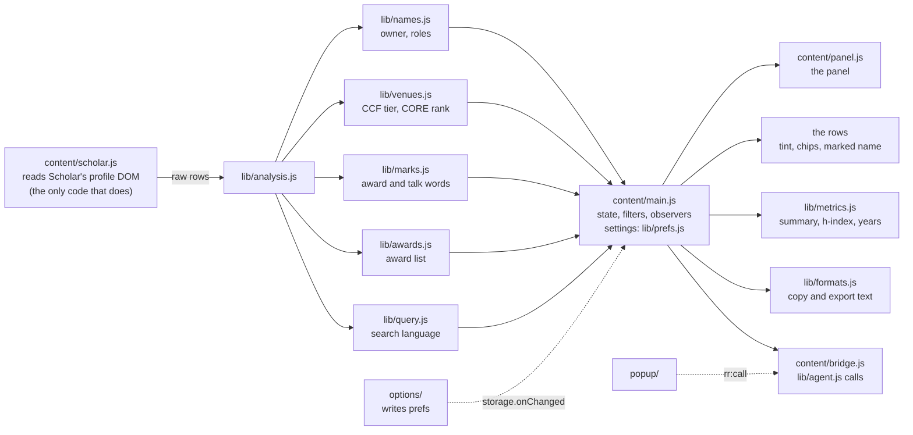
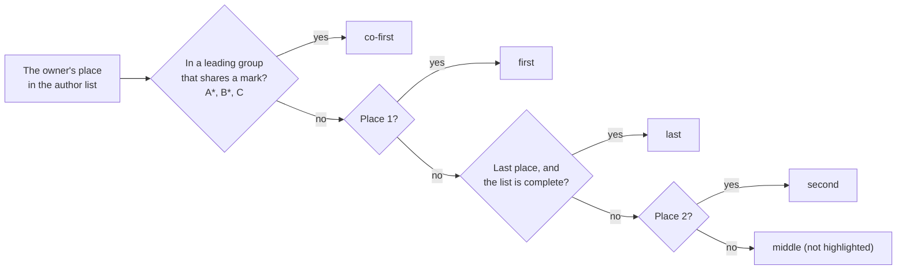

# Architecture

This is a Manifest V3 extension built for Chrome: **two content scripts, a toolbar popup and a settings page**,
one permission (`storage`), and a small service worker whose only jobs are to open the settings page for the
panel's button and to hand over the strings of the chosen interface language. It has no network access of its own
except the user-triggered read of a paper's own page on Scholar (*Read full lists*) and, only if switched on, a
title lookup at Semantic Scholar's public API. (It also presses Scholar's own *Show more* button for you, by
default — the page's script makes that request, see [Loading the whole list](#loading-the-whole-list).) The same
`src/` loads unmodified in other Chromium browsers; Safari is best-effort (see
[Platform policy](#platform-policy-chrome-first)).



`data/ccf.js`, `data/core.js` and `data/aliases.js` feed `lib/venues.js`; `data/awards.js` feeds `lib/awards.js`. The popup asks the profile tab
for `summary` and `export`. The settings page writes `prefs`, and open Scholar tabs redraw on `chrome.storage.onChanged`.

Everything under `lib/` is **pure** (no DOM, no `chrome.*`). Each file is a UMD-style script: in the extension it
attaches to `globalThis.RolesRanks`, under Node it is `require`d. That is what lets the unit tests exercise the real
code on real Scholar data, and why there is no build step.

## Components

| Path | Responsibility |
|------|----------------|
| `lib/names.js` | Normalise names, parse an author list, find the profile owner in it, classify the role, suggest spellings of the owner's name (`suggestVariants`). |
| `lib/venues.js` | Resolve a Scholar venue string to a CCF tier and a CORE rank (below). |
| `lib/marks.js` | Find the award and talk-level words an author wrote in a title or venue string (precision first); merge them with the award list's; the panel's award / talk rows and counts (`rows`, `summarize`, `summarizeKinds`). |
| `lib/awards.js` | The bundled list of award-winning papers: match a row by identical full title and the award's first author. |
| `lib/duplicates.js` | Entries that are one paper listed twice (same title apart from capitals / accents / punctuation, same first-author surname; not two venues the lists know apart, nor — neither a preprint — years more than one apart: a conference paper and its journal version are two): which one stays (the published one, then a ranked one, then one that shows the owner, then the most cited) and the citations it shows. Used when *Merge duplicates* is on. |
| `lib/analysis.js` | One row → `{ status, role, venue, marks, … }`, folding in a paper's detail page when there is one; `isHighlighted`; `needsDetail`; `queryMatcher(q, marksOf)`, which compiles a search query (`lib/query.js`) once into a test of a row — the words are looked for in the title, the author line, the venue line, the venue's abbreviation and name in each list, the year, the role and the marks that the settings leave on. |
| `lib/query.js` | The search language. `OPERATORS` — `cites`, `year` (compared with `>` `>=` `<` `<=` `=`), `ccf`, `core`, `role`, `type`, `has` — each with its value pattern, an example, the suggestions and a line of documentation; `POPULAR` (what the panel offers on an empty box); `parse(q)` → `{ terms, errors }` (an operator with a value it does not take becomes a term that matches nothing, named in `errors`); `matches(parsed, fields)`. The panel's suggestions, the agent guide and the matcher all read `OPERATORS`. |
| `lib/metrics.js` | h-index / i10 and the citation totals (highlighted and all), the role × tier summary (`summarize`, by role only with `source` null), matrix selection, the year bars (`yearBars`, at most `YEAR_BARS` = 50 years), top venues, unmatched venues. |
| `lib/formats.js` | The text of the copy buttons, the popup and the `export` call: `summaryText`, `summaryTsv`, `papersTsv`, `papersCsv`, `bibtex`, `markdown`, `apa`, `ieee`, `gbt`, `json`, the HTML flavours `summaryHtml`, `papersHtml`, `apaHtml`, `ieeeHtml`, and `venueParts`, the one reading of a venue line that the reference styles share (see [Exports](#exports)). Titles and names are treated as untrusted text. |
| `lib/prefs.js` | The screen, described once: `CARDS`, a card for each part of what the extension draws in the order it is drawn (`{ id, title, hint, rows }`; the settings page lists them in that order beside the preview), and `SETTINGS`, the cards' rows in one list `{ path, kind, def, doc, label, … }` (kind: `bool`, `choice`, `color`, `language`, `order`, `text`). Derived from it: `defaults()`, `normalize(raw)` (a complete, well-typed record; unknown keys dropped, wrong values back to the default; an order is always a whole permutation), `apply(current, patch)` → `{ prefs, applied, unchanged, ignored }` (imports, presets, the editor), `flatten()`. Also `NAMES` (the 48 texts a person can name: where each is drawn and its English words, checked against the catalogue), `PRESETS` (`all`, `last`, `first`, `minimal`), `CHIP_THEMES`, `normalizeUi`, and the rules: what is drawn (`listShown`, `lists`, `markShown`, `visibleMarks` for the search and the exports, `chipMarks` for the rows, `panelMarks` for the counts), which list's rank stands alone where both rank a venue (`winner` for the venue list and the notes of the copies, `chipLists` for the chips: `rows.prefer`, CCF first by default; between lists that are drawn only; the table, the search and the table copies keep both), the quick filters that are drawn (`pills`), which ranking the table uses (`sources`, `source`) and which copy buttons are on, in order (`copyButtons`). |
| `lib/palette.js` | The chips' colours from one colour per family (`ccf`, `core`, `award`, `talk`): `vars(family, hex)` → the custom properties (`--rr-ccf-1-ink`, …; the tiers fade, the text on a solid fill is white or near black by contrast), `on`, `mix`, `contrast`. `styles.css` reads them with the built-in colours as the fallback of each. |
| `lib/agent.js` | The calls of the page events and the popup: `METHODS` (`ping`, `summary`, `papers`, `export`, `filter`, `clearFilters`, each with its parameters and result), `validate(method, params)`, `EVENTS` (`better-scholar:request`, `better-scholar:response`, the marker `data-rr-ready`), `FORMATS` (= `COPY_BUTTONS`), and `guide({ current, version })`: the Markdown guide for AI agents, written from `SETTINGS`, `PRESETS`, `METHODS` and `OPERATORS`. |
| `lib/i18n.js` | The 30 interface languages, Scholar's `hl=` value for each, and Chrome's message format (`format`). |
| `content/dom.js` | `h()` (elements and text nodes, never `innerHTML`), `t` / `tn` (a name the person gave the thing first, then the chosen language's strings from the service worker, then `chrome.i18n`; `setLabels`, `tDefault` for what a machine reads), `useLanguage()`, the role colours as CSS custom properties `--rr-c-<role>` on `<html>` (`applyColors`), the row style (`applyRowStyle`), the chips' look and colours (`applyChips`), `copyText`, `downloadFile`, `issueUrl`, and the copy buttons' labels (`COPY_LABEL`). |
| `content/chips.js` | The rank and award / talk chips (what the panel marks for the editor: `data-rr-label`); shared by the Scholar page and the settings page's preview. A rank chip that stands for both lists (`rows.prefer`) carries `data-also` and names the other rank in its tooltip. |
| `content/store.js` | `chrome.storage` wrappers for every key (see [Storage](#storage-and-privacy)) and `onPrefsChanged`; degrades to memory if the extension context disappears. |
| `content/scholar.js` | Read rows, place the panel (sidebar when wide, above the list when narrow), press *Show more* until the list is complete (`loadAll`). |
| `content/semantic.js` | Optional (setting `semanticScholar`, off by default): one title lookup at Semantic Scholar's public API for a cut-off author list, used before Scholar's own page by `detail.js`; an answer counts only when its title and year agree, and its authors with the names the row shows (the ones before the cut first, in order; the ones after it last). |
| `content/detail.js` | Read a paper's own page for its full author list (user-triggered, throttled; stops at a CAPTCHA, a 403/429/503, a failed request, two pages in a row without an author list, and an orphaned script). |
| `content/panel.js` | The panel: renders a model, reports intent via callbacks, owns no state (below). |
| `content/image.js` | "Copy as image": draws the panel's role × rank table on an `OffscreenCanvas` (the role colours, mirrored for a right-to-left language) and returns a PNG; `main.js` puts it on the clipboard with the summary text, and the `export` call returns it as a data: address. |
| `content/bridge.js` | Carries the calls of `lib/agent.js` on two transports — the extension's own messages (`{ type: "rr:call", method, params }`, the popup) and page events — after `validate`; answers `{ id, ok: true, result }` or `{ id, ok: false, error }`; sets `data-rr-ready="true"` on `<html>`. What a call does is in `main.js`. |
| `content/main.js` | Wires it together: settings, filters, decoration, duplicate merging, observers, the keys (`/`, `Escape`), the calls (`methods`, handed to `bridge.install`). Also applies the language (`B.dom.useLanguage()` before anything is drawn; a changed language or Scholar language reloads the page) and the role colours. |
| `content/lang-redirect.js` | The setting *Open Scholar in*: a second, tiny content script (run at document start on `scholar.google.*/*`, checks the path itself: `/scholar` and `/citations` only — search, profiles, author search, paper details — never downloads or redirects) that reopens a page with the chosen `hl=`, once per tab and language. It reads one setting and nothing else. |
| `options/*` | The settings page (below): `options.js` builds it from `CARDS`, `editor.js` makes the preview a place to edit. |
| `popup/*` | The toolbar popup: asks the active tab for `summary` and reads the settings itself, then draws the table, the awards and talks line and the copy buttons the settings leave on, in their order and under their names; a button asks for `export` and copies the text (CSV: a file). |
| `background.js` | Opens the settings page when the panel asks (a content script cannot), and hands a page the strings of the chosen language from the extension's own `_locales`. Nothing else. |
| `data/*.js` | **Generated** from `data/*.json` by `scripts/build-data.mjs` (`ccf.js`, `core.js`, `awards.js`); `aliases.js` is curated by hand. |

## Script order

The main content script runs at `document_idle` on `https://scholar.google.<domain>/citations*`, in this order
(`manifest.json`; a test checks the dependencies):

```
lib/i18n.js → lib/names.js → lib/venues.js → lib/metrics.js → lib/marks.js → lib/awards.js → lib/duplicates.js →
lib/query.js → lib/prefs.js → lib/palette.js → lib/formats.js → lib/analysis.js → lib/agent.js →
data/aliases.js → data/ccf.js → data/core.js → data/awards.js →
content/dom.js → content/chips.js → content/store.js → content/scholar.js → content/semantic.js → content/detail.js →
content/panel.js → content/image.js → content/bridge.js → content/main.js
```

`prefs` needs `i18n` and `query`; `awards` needs `names`; `duplicates` needs `names` and `awards`; `analysis` needs `names`,
`marks` and `query`; `agent` needs `prefs`, `i18n` and `query`; the `content/` files need `dom`; `main.js` comes last
and calls `bridge.install`. The second content script — `lib/i18n.js`, `content/lang-redirect.js` — runs at
`document_start` on every page of the same domains. The popup loads `lib/i18n.js`, `lib/query.js`, `lib/prefs.js`, `lib/marks.js`,
`content/dom.js`, `content/store.js`, `popup/popup.js`; the settings page loads `lib/i18n.js`, `lib/query.js`, `lib/prefs.js`,
`lib/palette.js`, `lib/agent.js`, `lib/marks.js`, `lib/metrics.js`, `lib/venues.js` with `data/aliases.js`, `data/ccf.js` and
`data/core.js` (for *Check a venue*, which runs the page's own resolver on a text), `content/dom.js`, `content/chips.js`,
`content/panel.js`, `content/store.js`, `options/editor.js`, `options/options.js`.

## Author detection and roles

The profile owner is the text of `#gsc_prf_in`. `cleanOwnerHeader` strips honorifics,
suffixes and parentheticals (`Prof. John Smith, PhD`, `Wei Zhang (张伟)`).

Matching an author token to the owner (`names.js`):

- accents are folded and letters NFD cannot decompose are transliterated (`ł ø đ ß …`);
  names with no Latin letters at all (CJK, …) are compared by their own letters;
- Scholar collapses a multi-part given name into one all-caps token (`GE Hinton`,
  `WLH Smith`). Such **initials clusters** are expanded into letters before comparing, so
  the profile name `Geoffrey Hinton` matches `GE Hinton`. This was the largest single
  source of silent misses: 57 of 100 rows on a real profile;
- full given names must agree (`Jane` ≠ `John`); a single letter matches any name starting
  with it; an all-caps *name* is not treated as initials;
- family-name particles (`van der`, `von`, …) belong to the surname; `de/di/da/le/la` do
  not, because they are common given names;
- a surname joined by a hyphen or an apostrophe (`Carreira-Perpinan`, `O'Connell`) is a **compound**: it equals only
  another compound of the same words, never its last part (`MA Carreira-Perpinan` is not `Miguel Perpinan`'s,
  `H Molina` is not `Hector Garcia-Molina`'s) — `nameParts().compound`, checked by `sameSurname`;
- a two-word name keeps its second word (`Chidi Mba`, `Naoki Ii` are not a degree); a suffix (`Jr`, `PhD`) is taken off a longer name only;
- user-added spellings ("name variants", stored per profile, at most eight) are extra owner names. Chinese
  family-name-first order (`Zhang Wei` for `W Zhang`) is never guessed blindly — it would
  create false matches — but the page's own rows can show it: `names.suggestVariants` (pure)
  reads the other order of a two- or three-part header name **automatically** only when the name
  as printed finds the owner in under 10% of at least 8 rows, and the other order finds it in at least
  max(5, 4×) as many more rows and in a quarter of all rows (real case: `Tang Jie`, 0 → 76 of 100 rows). Other
  rearrangements with initials (`SY Philip` for `Philip S. Yu`, `J Tang`) and an all-caps inventor (`JA DOUDNA`: `isShoutedInitials`, only when the same initials written as usual find the owner elsewhere on the profile; an all-caps name is never read as initials by the matcher) are only **offered**,
  from complete author lists that otherwise lack the owner, in at least two papers, as a
  one-click suggestion; the automatic spelling is not stored (it is derived again on every load),
  a suggestion that is accepted becomes an ordinary variant. Once the automatic spelling is chosen the owner is `{ …, exactName: true }`: the profile name as
  printed then finds only its *identical* self (`Li Wei` printed `W Li`: `L Wei` is somebody else; `matchStrength`).

Author lists (`parseAuthors`) are cut at a cut mark (`…`, `⋯`, `‥`, two dots or more, `. . .`, `et al`) and told apart at `,` `;` `·` `|` the ideographic and
Arabic commas, a spaced slash, ` and ` and `&`; a name after a cut has no known position (`afterCut`: always middle, never in a leading group).



Roles (`roleFor`): co-first (the owner is inside the leading group of authors that share a mark with the first author — `A*, B*, C`, at least two, and not every author of a list of three or more; a lone mark or
one further down, a corresponding or co-senior author, says nothing; the envelope ✉ is never equal contribution) → first (position 0) → last (final
position, only if the list is *not* truncated) → second (position 1) → middle. In a
two-author paper the second author is the senior (last) author. Middle authors are not
highlighted.

A row's `status` is `found`, `hidden` (list truncated with `…` and the owner not in the
visible part — typically a senior author on a large paper) or `absent` (complete list, no
match — a name-spelling problem). `hidden` rows can be resolved from the paper's own page,
which lists every author in full.

## Venue matching

Goal: **precision first**. A missing badge is acceptable; a wrong one is not. The first
version of this matcher used loose substring matching and, on real profiles, mis-tiered
roughly one badge in five (CVPR as C, every unlisted "IEEE …" journal as A, "machine
learning" anywhere as ICML…). The rewrite has no fuzzy fallback at all.

`prepare(raw)` reduces what Scholar prints to the venue words: it drops `[arXiv…]`
annotations, the `…` truncation marker (remembered), trailing year / pages (also `pp. 1-18`, `Pages 1–10`, Roman front-matter pages, Oxford's `btac817`) /
article number (`Article No.: 137`, `Art. no. 12`, `No. 3`) / volume (issue) / state of the article (`early access`, `in press`), `Volume N`, leading ordinals and years, and records
whether a volume number was present. It also reads back the forms the rules below could not: IEEE Xplore's inverted conference title cut among the sponsors
(`Computer Vision and Pattern Recognition, 2006 IEEE Computer Society …` is `IEEE Conference on …` — the event word is a guess, so a clash with it is no reading), its citation form cut on the
acronym (`…, 2003. ISESE …`), a title in a publisher's series (`… - Lecture Notes in Computer Science`, `… X: Proceedings of the Tenth …`: a volume of proceedings — `viaSeries`, read
in the conferences only — and then no longer cut), the parts of the SMC journal (`Part B (Cybernetics)` is `Part B: Cybernetics`), and the `on - ACRONYM 'YY` of ACM's cut series form.

`typeHint` decides which index to consult: conference words (proceedings, conference,
symposium, `Advances in`) → conferences; journal words (journal, transactions, letters,
review, `Communications of`) → journals; neither → journals first, then conferences. A
volume number alone proves nothing (`ISCA 2014 42 (3)` is a conference).

Then, per ranking (CCF, CORE), the first rule that yields **one** venue wins; ambiguity
means no badge:

1. **Name** — canonical token key equality. Canonicalisation drops punctuation, stop
   words, ordinals, years and event words (`Proceedings of the`, `International`,
   `Conference`, …). Three variants are tried, strictest first: all words, without
   organisation words (IEEE/ACM/USENIX…), and without all-caps acronyms of real venues
   (`2020 CHI Conference on …`). Weakened variants need ≥ 2 words. Curated **aliases**
   (`src/data/aliases.js`) are indexed as extra names (`names`; `fullOnly` for a name whose organisation is part of what it says — "USENIX ATC" is not also "ATC"; `former` for the names
   a venue had that say "Workshop" — found by name, but not part of the venue's wording, so they are no type clash and are read only by the secondary-track exemption). Journals also match on the same
   words in a different order (`Audio, Speech, and Language Processing, IEEE Transactions on`).
   Venues whose names boil down to one key (ICS, *International Conference on Supercomputing*, and SC, *Conference on Supercomputing*; ISC and IFIP's *Information Security Conference*) are told
   apart by what the string says about the venue itself (`decide(…, picks)`, in this order): the acronym it names — in a parenthesis, in front of the event word (`EC '09: …`) or set off after the title
   (`…, SDM 2019`) — is the venue that has it; else the one whose own name (an alias counts) the string spells whole — years, ordinals, "Proceedings of the", "annual" and the little words aside, but
   "international", "ACM" and the event word kept (`literalKey`) — unless the string names an acronym of another venue (`Human-Computer Interaction (CHI)` is no journal). Only a tie is broken this way; a
   string that says neither is read as before (the first of venues that share a rating, else no badge). Venues that share an *acronym* (CCF's two SEC rows: IFIP's Information Security Conference and the ACM/IEEE Symposium on Edge Computing) are told apart by the sponsor the string names (`sponsored`: every organisation word of the string is in one candidate's names): "IFIP SEC 2019" is IFIP's.
2. **Acronym** — only strong signals: `(ICML)`, `(NSDI 11)`, `(USENIX Security 21)`,
   `(S&P'05)`, an unclosed `(OSDI …`, a leading `ISCA 2014`, a one-word venue (`Ndss`), or an
   acronym buried in a sentence when little else is said. Organisation words are never
   acronyms; a buried acronym is not used for journals or when much text surrounds it. The
   parts of a hyphenated parenthesis (`(EMNLP-IJCNLP)`) may name a conference, never a journal
   (`(WF-IoT)` is not the IoT Journal); joint-sponsor chains (`Eurographics/ACM SIGGRAPH`) carry
   no acronym of their own.
3. **Prefix** (only for truncated names) — a unique entry that begins with what is visible.
   Organisation words must agree; a trailing connective must agree (`Information processing
   in …` is IPSN, not IPMU); too little visible text stays silent. *Unique* means one venue: several
   different venues that merely share a rating are still ambiguous (the badge would be right, its
   tooltip would name the wrong venue). `Joint` is an identity word: a string that says it only
   reads as a venue that does (`… Annual Joint Conference of the IEEE Computer and …` is INFOCOM,
   not CIT).
4. **Subtitle** — a known conference name of four words (three, with a colon, in a string that says an event) followed by words that are set off: a colon, a dash, a comma, a full
   stop, a slash or a parenthesis, after the name and the event word that ends it (`…: Human Language Technologies`, `… Security Symposium, San Diego, California`). Words that go on
   with the name are another event's (`… Interactive Techniques in Australasia and South East Asia` is GRAPHITE), and a journal's title with words after it is a book.

Ties between entries with the same canonical key are broken by the event word in the
string (`symposium` → SoCC rather than the JCC conference); a journal and a conference of one
name are told apart by the acronym the string names (`Computational Visual Media (CVM)`).

**Guards.** Each is a veto that stops a weaker reading from beating a stronger one, and each
exists because a real string went wrong without it (the test that pins it names the string):

| Guard (in `matchSource` unless noted) | What it stops |
|---|---|
| `acronymAgrees` | a name hit that is another venue's when the string names an acronym — leading (`AAAI'17: …`, `SDM-19: …`), in a parenthesis (`(AAAI-07)`) or in capitals after the title (`Machine Learning: ECML 2004`, `Data Mining and Knowledge Discovery: PAKDD 2005`, `… Conference on Artificial Intelligence, AAAI 2019`: three letters or more, whether or not the same acronym stands in the name too; the hit's own acronym as printed — `… - C&C '05` — is no rival) — whose venue is not the hit (IJCAI's boiled name vs AAAI); the hit stays when its own acronym (an English word only in capitals), or its whole name — except against an acronym set off after the title —, is in the string; `nameBody` first reads an acronym repeated inside the name once — a leading acronym repeated inside the name (`AAAI-23: Thirty-Seventh AAAI Conference …`) is read once |
| `byContext` | two venues share an acronym (`FSE`): the one whose own words the rest of the string is |
| `subjectIsAnotherVenues`, `nameIsAnotherVenues`, `foreign`, `namedElsewhere`, `parenContradicts` | an acronym in front of, or next to, a name about something else (`ITS '14: … Interactive Tabletops`, `SIGGRAPH Asia`, `ACM SIGIR … (ICTIR)`); the venue's words are those of both lists' venue, not of another that squashes to the same acronym |
| `parenNameIsAnotherVenueOf` | a name of its own in front of a parenthesised acronym (`Innovations in Power and Advanced Computing Technologies (i-PACT)`, `… Devices, Circuits and Systems (ICDCS)`): more than half of the words before the parenthesis must be the venue's (its own segment; the same venue of the other list lends its words; a volume in front, or a joint event `(EMNLP-IJCNLP)`, is exempt); used by the parenthesis rule and the buried-acronym rule. Not stricter on purpose: sponsors the lists do not name (`ACM/EDAC/IEEE`, `IET`) and British spellings are noise, not another venue — what slips through (`… Information and Communication Systems (ICICS)`) is a `shadow` entry (`jointEvent` exempts a joint event) |
| series form | an acronym after a dash names the event, unless the title before the dash is the name of an event of its own that says none of the venue's words (`American Control Conference - ACC'95` is not CORE's Applied Computing Conference); a series title (`Advances in Cryptology`) and an ACM title that says the venue's own words (`… Conference on Programming language design and implementation - PLDI '02`) still name it (`dashForm`, `colonForm`) |
| `rawNamesVenue` | an acronym printed with `&` names its own venue (`C&C` is not `CC`) unless `idx.sameVenue` pairs the spellings (`S&P`/`SP`) |
| journal-abbreviation hint | (in `resolveUncached`) an acronym is no conference when it is a journal-only abbreviation with a page range (`TPAMI, 1-14`) or a one-word journal title (`GeoInformatica 12 (3)`); `prepare` marks `hasVolume`/`hasIssue` (a parenthesis that looks like an issue: `ISSUE_BODY`; a note is none) and an edition equal to the year's last two digits is no volume |
| `typeClash` | a string that says "Conference" is not the venue that says "Symposium"; the names a venue had that say "Workshop" count for the string's event word, not against it (`former` aliases) |
| `subjectIsNotOwn` | an acronym beside "Conference on <subject>" of three words or more, one of them not the venue's own (stems aside): `ACM SIGIR International Conference on Theory of Information Retrieval` is ICTIR, not SIGIR |
| `rivalNamed` | (in `acronymAgrees`) a hit whose name stands in the string while the acronym the string names is another venue's — of either list — whose name stands there too (the event word and the sponsors aside): `International Wireless Communications and Mobile Computing (IWCMC)` is the conference, not the journal of the same words; an acronym that is an English word counts only in capitals (`Networking Conference (WCNC)`) |
| `setOff` | (rule R5) a known name followed by more words is that venue with a subtitle only where the words are set off (a colon, a dash, a comma, a full stop, a slash, a parenthesis; a colon alone after a name of three words, in a string that says an event, and never a journal's title: that is a book): `… Interactive Techniques in Australasia and South East Asia` is GRAPHITE, not SIGGRAPH |
| `viaSeries` | (set in `prepare`, read in `matchSourceIn`) a title in a publisher's series (`… - Lecture Notes in Computer Science`, `… X: Proceedings of the Tenth …`) is a volume of proceedings: read in the conferences only, never as the journal of that title |
| the word "Joint" (name rule; `needsJoint` and `jointOnly` in the cut-name rule) | a string that says "Joint" is no venue whose names never do (`Joint Symposium on Parallel Processing`, `Joint Cloud Computing`); the years a venue was held jointly are aliases. And the other way round: a string that does not say it is no venue only whose names that do boil down to its words (`Annual conference on artificial intelligence` (KI 2010) is not IJCAI, `International Conference on Biometrics (ICB)` not IJCB; `idx.jointFree` holds the keys of a venue's names without the word — AAMAS's proceedings title and InSITE's own name are aliases), unless it names the venue's acronym (`Artificial Intelligence: IJCAI 2005`); a cut start that such a name would fit is claimed by none (`… International Conference on Natural Language …` begins IJCNLP's name as much as INLG's or the unlisted ICON's) |
| `otherJournal` (name rule) | a journal of the same words that is another journal: a listed "International Journal of …" without the word in the string (`Journal of Knowledge Management` is not IJKM; "Int." and "Intl" count), a listed plain "Journal of …" when the string says "International Journal" or "Int. J." (`International Journal of Computer Science and Technology` is not JCST), and a listed "Frontiers of …" when the string says "Frontiers in" (Frontiers Media's `Frontiers in Computer Science` is not FCS; journals only — a conference's name says either) |
| rare event words (name rule; `rareEvent` in the cut-name rule) | a congress, a colloquium, a forum or a summit is an event of its own kind — Scholar swaps conference, symposium and workshop, not these: `IEEE International Congress on Big Data` is not IEEE BigData |
| one word without the sponsor (name rule) | a name that is one word once its sponsor is dropped is not met, without the sponsor or the acronym, by an event of another shape (`shape`: the words in order without sponsors, "proceedings", "annual", "international", editions): `International Conference on Networking` is ICN, not IFIP Networking; its own shape is (ACM's `international conference on Multimedia`), and so is a line with no event word (`Proceedings Visualization'93`) |
| editions (in `resolveUncached`, `idx.editions`) | an edition the venue cannot have held in the line's year is another venue's: 18 venues whose names other events share have their numbering in aliases.js (`edition`: a year, its edition, the cadence — each checked against the venue's lines that carry its acronym); more than two editions off and the badge goes (`2015 18th International Conference on Computer and Information Technology` is Bangladesh's ICCIT, not IEEE's CIT) |
| `ofForOn` (name rule, with `otherJournal`) | a listed "Journal on X" (SIAM's) is not met by "Journal of X" (another journal), unless the line names the venue's acronym (`INFORMS: Journal of Computing`) |
| an event word the venue does not have (`sponsorOnly`, acronym rule) | an acronym beside "<event> on <subject>", where the event word is not the venue's and a subject word is not the venue's own, is a sponsor: `ACM SIGGRAPH symposium on Videogames` is Sandbox — SIGGRAPH is no symposium (`SIGCOMM 2008 conference on Data communication` keeps SIGCOMM) |
| another script (in `resolveUncached`) | a line written mostly in Cyrillic, Han, kana, Hangul, Arabic, Hebrew, Greek, Thai or Devanagari letters names no listed venue, whatever Latin acronym stands in it (`第38届中国控制会议 (CCC 2019)`) |
| another publisher (in `resolveUncached`) | a journal's abbreviation behind a publisher its own names do not name is that publisher's journal: `IEEE TOS` is not ACM's TOS |
| IEEE regions (name rule) | `IEEE Region 5 Conference` is not TENCON, Region 10's |
| journals that are a conference's proceedings (in `resolveUncached`) | issue 2 of *Proceedings of the ACM on Management of Data* from volume 2 (2024) is PODS's, the other issues SIGMOD's; *Proceedings of the ACM on Software Engineering* is a venue only with its issue's FSE or ISSTA; JMLR's *Workshop and Conference Proceedings* (`W&CP`, dblp's `Proceedings Track`) are no journal |
| `ownWord` | a track word (in `resolveUncached`): see below |

**The same venue in the other list.** CCF and CORE word many venues differently, so one list's wording often finds a string the other's does not. `buildIndex` links the rows that are one
venue (`idx.partners`): an alias that names both (`ccf` and `core`; the tiers it names pick the rows), or one acronym and mostly the same words (≥ 2 shared and ≥ 60 % of the shorter name's, stems aside; or the same single
word — MICRO, ACM MM, VIS — the two FSE rows of each list share too few to be linked, nor CC / C&C, ISC, GI: a test names them). After both lists have been read, a match in one list brings the partner row of the other when that list found nothing, the string was not refused, and
the string's track words are the partner's own — or the string is the whole official name of the row that found it (`ownWord(…, whole)`: CCF's NOSSDAV is "International Workshop on …", CORE's has no "Workshop"; "NOSSDAV Workshops" are tracks) — and the match was not a pick among venues that only share a rating (`decide()` takes the first: "International Conference on Data Mining" is ICDM or SDM) unless the string says the venue's own acronym. It adds a badge; it never changes or removes one. An acronym with its year written against it (`ASE'19`, `CC'19`, `ICLR2020`: `unglue` / `glued` in `acronymSignals`) is an event, as `ASE 2019` is; the one-word-venue rule does not take such a word whole. Whole-name lookup also reads British and American spellings alike (`us()`: "Modelling" and
"Modeling"); the start of a cut name keeps its spelling. Sponsors the lists do not name (`ORG`: `iapr`, `wic`, `edac`, `esda`, `eai`, `sigchi`; `cfv`, the typo of CVF) are no part of a name — not `acis` and `iet`, which name events of their own (ICIS's "IEEE/ACIS", the IET's Image Processing conference): CORE's SERA, whose name begins with ACIS, is an alias without it.

**The person's own venue mappings** (`data.mine`, from the settings page; synced as `mine`). A venue line that no rule ranks can be tied by the person to a row of a list.
Such a mapping fills gaps only: it is read last, and only when neither list matched, the string was not refused and has no track word. Its key (`mineKey`) is the whole name as
printed, less only years, ordinals, numbers, "Proceedings of (the)" and an acronym in brackets; a name made only of sponsors, publishers and institutions ("IEEE", "Springer") has no key — the same venue in another edition, never another event word, a track or a cut name. A row the list
no longer has drops the mapping. The result's rule is `mine`: the chip is dashed with a dotted tier, its tooltip says "Your own mapping", copies write "(your mapping)", the
panel and the popup count such papers in a line of their own, the copied summary carries a note, and the `papers` call marks the rank `mine: true`.

**Where the two lists disagree.** After both have been read: an acronym reading loses to the other list's whole-name reading of another venue, and the other way round; two readings by name that name different venues are first weighed — one made from the whole name as it is spelled, the other only once the sponsor or an acronym of the string was left out (`weak`) or against its event word (`clashed`): the whole name stays, and the other list's row of that venue comes with it (IFIP's *Information Security Conference* is CCF's SEC, not CORE's ISC; *International Symposium on Neural Networks* is CORE's ISNN, not CCF's IJCNN) — and when neither is stronger, as two readings by prefix, both are dropped; a prefix reading
loses to the other list's whole name — unless that name's event word is not the string's (a symposium for a "Conference on …": the whole name is `clashed`, a weak reading, and the two disagree, so both are dropped). A cut shows a venue only by its start, so a clashing rival of another event word is no other reading of
it where the visible start has two content words besides the sponsors (`visibleContent`; "IFIP/IEEE International Conference on …" shows none and claims nothing). A string that says "Joint" is no venue whose names never do; the years a venue was held jointly (RE, SIGMETRICS, InSITE, WI) are aliases. Events of the name a ranked
venue's words boil down to are `shadow` entries of their own: by acronym (`ICAI`, `{ acronym: "ICCS", with: "circuits" }`), or by whole name (`{ name: "ACM Symposium on Applied Computing" }`: the name the string *spells* — `literalKey`, event word and "ACM" kept — so that "ACM Conference on Computer Graphics and Interactive Techniques" is SIGGRAPH and "Proceedings of the ACM on Computer Graphics and Interactive Techniques" is not); the acronym of Springer's series form (`Supercomputing: 29th International Conference, ISC 2014`) honours the shadows too.

**Secondary tracks** — Findings, workshops, demos, posters, tutorials, extended abstracts,
short/industry papers, shared tasks — get no badge, unless every track word of the string is one
the venue's own name holds. `ownWord` has two ways in. (a) The venue's official name holds the word
(IWQoS, HotNets): exempt — but where the string says "Workshop on <subject>", the subject must be the
venue's own words (spelling and endings aside; a cut string needs two words of it that begin the subject of one of its names), or it is
another workshop (`PKC 2019 Workshop on Post-Quantum Cryptography`); a `renamed` row (CORE's WACV, still
listed as a Workshop) has no such name. (b) A name the venue had (`former` or an alias; the notes of CORE's
names, `prior to 2009 was …`) holds it: the string's name part — without volume, pages, year and
parentheses, with ordinals, years, "proceedings", "international" and sponsors out on both sides — must
BE that name, its own acronym before or after it allowed (`International Workshop on Artificial Intelligence and
Statistics` is AISTATS; `NIPS Workshop on Machine Learning`, `ICML Workshop on Machine Learning for Music` are tracks). A cut name is no
whole name (it may go on: `… Search-Based Software …` is Engineering or Testing): only the start of it counts, four
words of its own besides the track word and the connectives, all there is before the cut. The result says the word
(`secondary`) and, when a listed venue was matched — or the string without its track words names one that is
not a journal — and its badge withheld, `refused`: the panel's *Not ranked → secondary tracks* counts those and not every
string with a track word (a journal called "Surveys & Tutorials" is not a track of anything). A list whose row is blocked by a track word its name lacks is un-blocked when the other list's row of the same venue (`idx.partners`) carries the word and the string is that row's whole official name (the same `whole` reading). Results are memoised per string
and carry the rule and entry that matched, which the chip tooltip shows.

The behaviour is pinned by `test/venues.test.js`: targeted regression cases for every bug found
in the audit, and a reviewed **snapshot** of the result for every venue string in the
real-profile corpora (`test/fixtures`). A change that moves any badge fails the test until the
diff is reviewed and `npm run test:update` is run.

## Data

`data/ccf-2026.json` is extracted **reproducibly** from CCF's official PDF
(`scripts/ccf/`, see [`data/README.md`](../data/README.md)); its totals match the published
catalogue (386 + 295; A 95 / B 245 / C 341). `data/core-2026.json` comes from the ICORE
export (`scripts/core/build-core.mjs`; 800 ranked conferences). `scripts/build-data.mjs` turns both, and
`data/awards-2026.json` (7,830 entries), into `src/data/*.js`; a test fails if they are stale.
`.github/workflows/data-fresh.yml` runs `scripts/check-data-fresh.mjs` every Monday: it fails when the
official CCF file or ICORE export no longer matches the checksum the data was built from, is gone, or a newer
edition is offered (exit 1), and when a source cannot be reached or refuses the check (exit 2, no verdict).

Tiers are those of the current lists. They are *not* the tier at publication time, which the
UI says in the panel note and in every chip tooltip.

## Loading the whole list

Scholar shows the first papers of a profile and loads more each time its *Show more* button is pressed. The role × rank summary
is only as good as the papers it has seen, so `scholar.loadAll()` presses that button until it is disabled — started by
`main.js` shortly after the page loads when the `autoLoad` setting is on (the default), or by the panel's *Load all*
when it is off. The request is Scholar's own script's, made to Scholar exactly as a click of yours would make it; the extension
adds no network access and no permission. It is polite and fails soft: one press at a time, waiting for the rows to arrive,
about a second apart, and an automatic run presses only while its tab is the one being looked at, holding a short-lived lock in
Scholar's `localStorage` (`rr-load-lock`) so that profiles opened in many tabs at once do not press together; a press that brings
no rows within nine seconds ends the automatic run at once (a manual one gets a second try) and the panel says so; *Cancel* ends it
and it does not start again by itself; switching the setting off ends a run it started, and switching it on starts one on the open
profile (unless *Load all* is running: that run goes on as it is). While either runs, the panel does not offer *Read full lists*, so
that Scholar never gets both at once from a tab. `loadAll` returns why it stopped (`done`, `cancelled`, `stalled`).

## The panel

`panel.js` is a pure view over a model. `main.js` rebuilds the model after every change
(settings, filters, new rows from *Show more*, resolved papers) and re-renders; rows are
decorated by toggling classes (`rr-r-<role>`, `rr-hide`) and appending one chip
container — no `innerHTML`, and the author line's text is never altered (name marking
rebuilds it from the original text and restores it on undo). Venue resolution is
synchronous and cached, so decorating cannot re-trigger the row observer. The panel moves
between the right sidebar (wide window) and the space above the list (narrow window, where
Scholar drops the sidebar *below* the list) as the window is resized. Styles are scoped under
`#rr-panel` and out-rank the reset that stops Scholar's global button/input styles bleeding in.

What it shows, and in what order, is decided by the settings, never by the panel itself (it holds only per-visit view state: folded
or not, the ranking tab). The parts are the `panel.<part>.show` rows of `SETTINGS` and the order is `panel.order` (`SECTIONS`):
`table` (the role × rank table and its note), `copy` (one button for each `panel.copy.*` switch that is on, in `panel.copy.order`),
`marks` (awards and talks counts), `filters` (the search box, the quick filters in `panel.filters.pills.order`, *Only highlighted*, the
year range), `metrics` (citation totals), `years` (papers per year), `venues` (the only part off by default), `status` (loaded
papers, *Load all*, *Read full lists*, repeats, absent names, unranked venues) and `names` (the spellings found, the box that adds
one). Every thing in a part has its own switch (`panel.table.total`, `panel.metrics.h`, …), so what is drawn is described one thing
at a time; the title bar (`panel.header.*`) and the bar that says the list is filtered (`panel.filters.bar`) are the panel's own.
The parts are flat children of one container in the order of `panel.order`; in the wide layout (above the list) CSS columns run
them in two columns, top to bottom, and `rr-onecol` says there is one. A thing carries `data-rr-part="<its switch's path>"`, a text
that can be named `data-rr-label="<message key>"`, and a list that can be put in another order `data-rr-order` with `data-rr-item` on
its items: the settings page's editor reads those. The words are set by `relabel()` before every update, so a name typed in the
settings is used at once. A thing that nothing draws is also left out of the search and the exports ("what you see is what you
search and copy": `prefs.lists`, `prefs.visibleMarks`); a filter whose control the settings took away is cleared (`pruneFilters`
in `main.js`). A part added later needs: a row in `CARDS` (its words in every `src/_locales/*/messages.json`), the panel drawing
it under that switch with `data-rr-part`, a place in the preview's sample, and an end-to-end check (the control and the order of
the settings against the preview are checked for every row).
The controls are components of the panel's own, not the system's: the year range is `dropdown()` (button, fixed-position list,
arrow keys, Escape, click outside), the one checkbox is styled as a switch (`role="switch"`), the search box is a combobox whose
suggestion list is placed with fixed coordinates.

*An update under an open page.* Chrome updates an extension while it runs, and the script of a Scholar page opened before is then cut off
(as when the extension is reloaded or switched off): its settings no longer reach it, its Settings button opens nothing, and `chrome.i18n`
answers nothing. `main.js` notices it when the tab comes back into view or Settings is pressed (`chrome.runtime.id` is gone) and the panel
says so in its top bar, with *Reload this page* (`extUpdated`, `reloadPage`, read when the panel is made). The panel keeps its words when it
is drawn again: `dom.js` keeps a spare copy of the language's strings, asked of the service worker once at the start (`rr:messages`, not
waited for), and formats from it where Chrome's lookup answers nothing. Storage falls back to memory (`store.js`), and loading stops.

### Search

The search box (`/` focuses it when the panel and its filters are shown) feeds `state.filters.query`; `main.js` compiles it
once per query and per set of visible marks (`analysis.queryMatcher`). Typing an operator's colon lists that operator's
suggestions (`OPERATORS[].suggest`), `↓` or the `/` hint lists `POPULAR`; `Enter` / `Tab` take a suggestion chosen with the
arrows, otherwise `Enter` / `Shift+Enter` step through the matching rows (`rr-row-focused`). A query with errors marks the box
`aria-invalid` and names them in its tooltip. Four quick buttons toggle by default `ccf:a`, `cites:>100`,
`role:first` and `has:award`. `type:conference` and `type:journal` read the kind the rank lists give the venue (CCF's own, else CORE's; a list that is switched off does not tell, and a venue without a rank has none).

*What a profile page costs* (measured 2026-10-29, a fast laptop, 100 papers, warm): the extension adds about 140 ms of main-thread work and
the panel is drawn about 140 ms after the page starts; the heap grows by about 8 MB (the award list 2.3 MB of it, and 15 ms). Of the
script time, reading the rows is about 40 ms (the venue lines 26, the award and talk markers 8, the names 5), building the matcher's
index about 28 ms, drawing the panel about 18 ms; the 1.7 MB of scripts are compiled once and cached by Chrome (the award list costs
about 10 ms to load). Loading 1,000 papers adds about 400 ms of script in all, spread over the batches (no batch reads every row again).
The settings page draws its preview in about 130 ms, the popup its summary in about 35 ms. `node scripts/bench-matcher.mjs` times the
matcher: its index about 22 ms, a venue line about 70 µs (they were 55 ms and 110 µs before each text was tokenized once and each word's
noise test and each fold kept — `baseTokens`, `noiseSeen`, `foldSeen`).

### Filters and what they scope

`state` in `main.js` holds the filters: `selection` (a matrix cell, role or tier), `markGroup` (an awards / talk row), `venueKey`
(a venue of the top-venues list) and `filters` (`onlyHighlighted`, `yearStart`, `yearEnd`, `query`, `minCitations` — set only by
the `filter` call — and `impact`). `applyFilters()` toggles `rr-hide` on rows (every key and click runs `refresh()` over all rows, with no
delay: measured 2026-10-29 on 2,000 papers, a key is 5–15 ms of script; the costliest click is a pick undone, ~100 ms, most of it the browser laying out the
rows shown again, forced when the redrawn button gets its focus back (without that the same layout comes after the script, and the
task is as long) — under 200 ms, so nothing is deferred; e2e section 26 keeps 1,000 papers under 250 ms, and checks that 30 rounds of searches and picks leave the
page with as many nodes and listeners as before: over 400 rounds the heap stayed flat, after a first round has warmed it up. On a CPU
slowed 4× (Chrome's emulation of a low-end laptop) 1,000 papers stay near 200 ms and 2,000 reach 400–450 ms for a pick undone, almost
all of it the browser styling and laying out the rows shown again — "Only highlighted" off: 31 ms of script, 254 ms in all. Hiding
rows with `visibility: collapse` instead of `display: none` was measured too: showing got a little cheaper, hiding two to three times
dearer, so `display: none` stays; only drawing fewer of Scholar's rows at once would go further); `filtering()` says whether any is on, which shows
the panel's filter bar ("Showing 25 of 100 papers · Last, CCF A · 2020–2024" and *Clear*). The bar stands in the title bar in place of the title (one line,
the whole text on hover, a `role="status"` so that it is said when it changes; with no title bar it stands in front of the parts), so that a filter does not
make the panel taller: nothing under the pointer or the caret moves — which is also why the awards rows stay, quiet, while the filters leave none of their papers
(`marksWhole`). `Escape` on the page clears them all when nothing else has taken the key. The numbers under the filters follow them (`scoped()`: highlighted papers, citations,
h-index, i10, the venue list — the venue list is not narrowed by its own choice). So do the role × rank table, the awards and
talks counts and the panel's copy summary and copy table (`counted()`, `tableSummary()`; the setting `panel.filters.follow`, on by
default): they count the papers the narrowing filters leave (`scopeFiltering()`: the venue, *Only highlighted*, the years, the
search words, the least citations, the papers behind the h-index). The cell picked in the table and an awards row are picks: they
list papers and narrow no count (`passes(…, skip)` with `selection` and `marks`), so that picking one never empties the list it
is picked from and what is copied is what the panel shows. The table keeps the rows of the whole profile (`summarize(…, { keep })`)
and the copied text says what it counted ("Showing 25 of 100 papers · 2021–…": a line under the summary's title, a row under the
tab-separated table, the caption of the real table). Only the year bars stay whole (a range is chosen against them), and so do
the coverage lines (loaded, hidden, absent) and the toolbar popup; the `summary` and `export` calls count every paper unless
they are given `filtered: true` (the panel's way of counting). The minimum of the h-index filter for the *counts* is worked out
without the picks (`impactMin(source, { picks: false })`), so that a pick never moves it and with it the counts; the list and the
button use the h-index as the button says it, picks included, so that the button lists the papers behind its own number. A paper
with no year is in no year range.

The impact filter is the h-index and i10 buttons: it shows the highlighted papers behind the number — at least *h* citations,
*h* being the h-index of the highlighted papers the other filters let through (`impactMin()`), or at least 10. The totals do not
count it (`skipImpact`), so the number that was pressed stays put.

A filter whose control has gone is dropped: a venue that left the list or a tier column that disappeared, in `refresh()` after
`decorate()` (a row's `highlighted` is only known once it has been decorated); a selection, an awards row, the search, the year
range or the impact filter whose part of the panel was switched off, when the settings change (`onPrefsChanged`). The `filter`
call is refused while the panel is off, and leaves out (`ignored` in its answer) a filter whose control the settings took away
(the search box, the filter bar for `minCitations`, the citation totals for `impact`), for the same reason; with the search box
off only the words of the shown quick filters stay in the query.

What the table and the status block show depends on the profile, not only on the settings. `listComplete()` in `main.js` says the whole list is here: the page offered nothing more at the start,
or our loader ran to its end (`done`), or rows arrived that the loader did not ask for and Scholar's button is still off after the moment it needs to come back (a list finished by hand, or a cancelled request answered) — not straight after a cancel or a stall, because the button is disabled while a request is in flight. `noRanks()` is true when a list is switched on, the list is complete
and no paper has a rank in any list that is on: the table is then by role only (`summarize(list, null)`, heading *Papers by role*, no tier columns, no switch between the lists; the lists that are on stay in
`sources`, for the note `noRanksNote`; the toolbar popup empties its own `sources`), and a selection on a tier is dropped in `refresh()` (its control is gone). The unranked-venues list keeps its *Report* link:
a computer-science profile whose venues the lists miss is exactly where a report helps. The status block (`renderCoverage`) leaves out the "N papers loaded" line when it would stand alone — complete,
not loading, nothing else to say — and the totals are shown (not with the layout warning, which hides them); the section hides itself when nothing else is left.

The year chart is `metrics.yearBars()`: one bar a year for the highlighted papers, at most the last 50 (`YEAR_BARS`; two real veterans' profiles span 44 and 45 years, and above 24 bars the gap between bars shrinks to 1 px) counted back from the newest year that can be real (next year at
the latest: a typo such as 2099 draws nothing), starting at the first year that has a paper; Scholar sometimes dates a paper 1803, which would stretch the chart over two centuries and leave
every bar a pixel wide. The papers before the first bar are counted (`byYearOlder`) and said in the first axis label's tooltip and in the chart's accessible name (`yearsOlder`).

Layout: in the wide layout (window narrow, panel above the list) the parts are set in CSS columns (`columns: 2 280px`, `rr-onecol` when the panel is one column wide); the
arrangement is redone when the window crosses the breakpoint. When Scholar's layout has changed (`layoutBroken`) only the warning (top slot) and the loading status are shown.

## The toolbar popup

The popup sends `{ type: "rr:call", method: "summary" }` to the active tab (`chrome.tabs.sendMessage`; no `tabs`
permission is needed for that). The answer carries the numbers only: the three summaries (CCF, CORE, by role only), the awards and
talks counts, the citation totals. What to draw is read from the settings by the popup itself (`B.store.loadPrefs()`), so it obeys the
same switches, order and names as the panel. A copy button asks for `export` and copies the text (with its HTML, or for *Copy as image* the `png` the page drew); CSV is saved as a file. A tab that
is not a profile gets no answer, and the popup offers to open Google Scholar.

## The settings page

`options.js` builds the page from `CARDS`: a card for each, in that order, which is the order of the preview from top to bottom (an
end-to-end check measures it). A switch is a `bool` row; the switches of a part hang on its `show` switch (`parent`) and are
greyed while it is off; a name (`text` row) sits on the row of its switch; an order (`order` row) is a list with move buttons.
Every control carries `data-pref="<path>"` (the API key's field is `data-pref="s2key"`, not a setting), and an end-to-end
check fails when a `SETTINGS` row has no control or a control names no setting. Bespoke parts: the colour studio, the chip looks
(ready-made looks drawn on their own buttons: the look is a few inherited custom properties, so the nearest class wins), the key
field, the configuration card, the saved data. A change is shown at once and written within 600 ms (a name as it is typed, a colour when the picker is closed; `chrome.storage.sync` takes 120
writes a minute and refuses silently: runs of changes are coalesced, a refused write is shown and made again after 10 s or when the page is left, and the page's own echoes — its writes not yet seen back, in order — are not
taken for another tab's change); open Scholar tabs redraw on `chrome.storage.onChanged`. The cards: *Language*, *Highlight my
papers*, *Colours*, *Chips on each paper* (and their look), *Summary panel*, one card for each part of the panel, *Scholar's own
blocks*, *Duplicate entries*, *Paper list*, *Semantic Scholar*, *Check a venue*, *AI agents*, *Configuration & presets* and *Saved data*. Groups of
switches have *Enable all* / *Disable all*. A search box and a row of links to the cards sit above them.

The preview is an editor, not only a picture (`options/editor.js`). Hovering a setting outlines what it draws; hovering a thing in
the preview shows a tag (✕ hides it, ✎ renames it, ⠿ moves it where it has an order, ⚙ shows its setting) and a part of the panel a rail (hide, move, setting);
a double-click renames a name and on anything else jumps to the setting that draws it (`jump(path)` of `options.js`: the row is scrolled into view, flashes and takes the keyboard; a
search of the settings that hides it is cleared first); a tray lists what is hidden, one click to show it. The overlays are children of the preview's card, placed
by measuring, because the preview is drawn again after every change; all of it changes the same record as the controls (`put` /
`save`), so the two sides are one. The preview is a picture for the eye and the mouse: `quiet()` takes it out of the tab order and the
accessibility tree after every drawing (the controls on the left are the page for a keyboard and a screen reader; the tray stays for use).

For the keyboard, a row of like buttons is one Tab stop (`rove()` in `options.js`; the year bars of the panel do the same): the section links under the header and
each colour row, the arrows (mirrored in a right-to-left page), Home and End move among them and the one that is on, or in view, is the stop — 22 links and 40 swatches
did not stand in front of the first setting any more. In one column (a window under 960 px) the preview is a sticky strip of at most 40% of the window's height that
scrolls inside, so that the settings are in the first screen and a change is seen as it is made; a link to a section scrolls it to just below the strip.

*Check a venue*: a box that runs `venues.createResolver` (the page's own, over `data/ccf.js`, `data/core.js` and `data/aliases.js`) on the text
and draws what it finds with the chip code of the panel: each list's rank, the matched name, the rule (`chips.ruleText`), and for a CCF venue its
research area (the list's own Chinese words, or an English name for the other interface languages) and a plain link to its DBLP page; or why there
is no rank (a secondary track, `res.secondary`, or no certain match). The panel's unranked list has a *Check* link on each venue: it leaves the text
in `chrome.storage.local` (`askVenue`, at most 300 characters), asks the service worker to open the settings page (the same `rr:options` message as
the gear), and the settings page takes the text (`takeAskedVenue`, also when it is already open: `storage.onChanged`), fills the box and shows the card.

*Configuration & presets*: a preset (`PRESETS`: *All features*, *Last author focus*, *First author focus*, *Minimalist*), the
JSON editor and *Import file* all go through `prefs.apply()`, and the page reports what was applied and what was ignored, with
the reason. *Copy configuration (JSON)* and *Export file* (`better-scholar-config.json`) give the whole record. There is no other
format and no import from the clipboard.

The preview is the real `content/panel.js`, handed a model built from invented papers (`panelModel()` in `options.js`
follows `main.js`'s `model()`), above sample rows built from `content/chips.js`. It is always Scholar's light page, whatever
the system theme.

## The web demo

The settings page also runs in an ordinary web page: the project site embeds it as its *Try it* section, and a visitor can open it on its own.
`npm run build:demo` (`scripts/build-demo.mjs`) writes `dist/demo/`, a static copy of the real page. The builder reads the page `options_ui` names in
the manifest and copies exactly what that page names (scripts, stylesheets, pictures, what a stylesheet's `url()` names), each at the same path
under `src/`, plus the icons and every language's `messages.json`; it takes the page's own `<script>` tags out and puts one tag in their place,
for `scripts/demo/shim.js`, whose `data-` attributes carry the scripts, in the page's order, and the version. `--out <dir>` writes somewhere else (the
site's build asks for its own `_site/demo` that way). Serve the folder over http (`python3 -m http.server -d dist/demo`): from `file://` the browser
refuses to read the strings.

The shim is the only addition, a `window.chrome` with just what the page and its libraries touch: `chrome.storage.sync` and `local` (`get` with
Chrome's key, list, defaults and everything forms; `set`; `remove`; copies in and out, `onChanged` with a real `changes` object for the page that wrote and
for the demo open in another tab), `chrome.i18n` (`getMessage` answers at once, from the strings of English and of the interface language, which the shim
fetches before it adds the page's scripts; `getUILanguage`) and `chrome.runtime` (`id`, `getManifest`, `getURL`, `openOptionsPage`, `onMessage`, and
`sendMessage` for `rr:messages`, answered as `background.js` answers it). The settings are kept in `localStorage` under the prefix `rr-demo:` (in memory
when `localStorage` is not there). `?lang=` (a site code such as `zh-CN`, or a folder such as `zh_CN`) is what `getUILanguage()` returns, otherwise the
browser's language, and `lib/i18n.js` `resolve()` picks the folder, as in the extension. A page that starts asking for more of `chrome.*` fails with a
TypeError in the shim: add what it needs there. The demo asks for its own files only (`test/e2e/demo.mjs` checks that), and adds one quiet line
(`scripts/demo/demo.css`) saying that its changes stay in this browser; inside a frame, as on the website, which says it in the visitor's language, the
line is not shown.

It is not the extension: there is no Scholar page to redraw (the preview is all there is), *Open Scholar in* and the Semantic Scholar switch only save a
value, the page's footer still says the settings sync with a Chrome profile, and the Semantic Scholar key field keeps whatever a visitor types in memory only (`MEMORY_ONLY`
in the stand-in: it is never written to `localStorage`, and a reload empties it).

## Calls: page events and the popup

`lib/agent.js` lists the calls; `content/main.js` implements them (`methods`); `content/bridge.js` carries them.

- **Page events.** A script on the profile page dispatches `better-scholar:request` on `document` with
  `detail: { id, method, params }`; the answer is a `better-scholar:response` event with `{ id, ok: true, result }` or
  `{ id, ok: false, error }`. An `id` that is a string or a number comes back unchanged; anything else comes back as `null`.
  There is no origin check: any script in the page can call. `bridge.install` sets `data-rr-ready="true"` on `<html>`.
- **Messages.** The popup sends `{ type: "rr:call", method, params }`; `chrome.runtime.onMessage` reaches this extension's own
  pages only.
- **The calls.** `ping`, `summary`, `papers` (`filtered`), `export` (`format`, `source`), `filter` (`query`, `onlyHighlighted`,
  `yearStart`, `yearEnd`, `minCitations`, `impact`) and `clearFilters`. `validate()` checks the method and every parameter
  (type, choice, integer range, strings up to 500 characters) before anything runs. They read what the panel shows and set the
  page's filters; none reads or writes the settings or storage, and none makes a network request.

## Exports

`lib/formats.js` turns the paper records (`paperRecords()` in `main.js`: the rows the page shows, with the author list that
*Read full lists* saved, the profile's venue line — the paper page's venue only where Scholar cut that line — and the page's range) or the summary into text. *Copy summary* and *Copy as table* (`summaryText`, `summaryTsv`,
`summaryHtml`) count the papers the filters leave when it is the panel's button (`filtered: true`; the popup and the page calls
count every loaded paper) and carry `notes` under the scope line: the profile's link and the day (`panel.copy.source`) and, when
the list is not all here, `Not fully loaded` (`copyNotes()` in `main.js`); the others take the papers shown. *Copy papers* is tab-separated (`papersTsv`), *Export CSV* is
RFC 4180 with a UTF-8 byte-order mark and CRLF line ends (`papersCsv`); in both, a cell that begins with `=`, `+`, `-` or `@` and
is not a plain number gets a leading apostrophe. BibTeX keys are surname + year + the first title word of three or more letters
that is not a stop word (`he2016deep`, `nodate` without a year), made unique with `b`, `c`, …; the author list ends `and others`
where Scholar cut it, and every character TeX reads is escaped. Markdown escapes what Markdown reads; APA keeps surname
particles (`van der Maaten, L.`). JSON is `{ owner, source, total, papers }`.

The four reference styles (BibTeX, APA, IEEE, GB/T 7714) share one reading of Scholar's venue line. `venueParts` splits it into
name, volume, issue, pages and year, and only in shapes it knows; a line it cannot read whole stays in the name, as printed, never
half read. `entryType` says journal or proceedings from the rank lists' type and the line's words; `periodical` takes an unclassified
line with a volume as a journal's unless its name says meeting, book, report or web address; patents, theses, reports and publishers
(`isDocument`) are given as printed. A proceedings' number is labelled a volume only beside a page range and never after a bare
acronym ("IJCAI 16" is an edition); otherwise it follows the name as printed. `test/formats-snapshot.test.js` keeps the reviewed
GB/T reading of all 22,744 real lines (`test/fixtures/formats.expected.json`): a change shows its exact effect, as the venue
snapshot does for the matcher (CONTRIBUTING.md, *Changing the reference styles*).

Six buttons put a second flavour on the clipboard: *Copy as table* (`summaryHtml`), *Copy papers* (`papersHtml`), *Copy APA* (`apaHtml`), *Copy IEEE* (`ieeeHtml`), *Copy ACM* (`acmHtml`) and *Copy GB/T 7714* (`gbtHtml`) also give HTML (the references with the owner's name in bold while `rows.name` marks it), so a word processor pastes a real table or real italics, a link and a hanging indent where a spreadsheet or a text box takes the text (`dom.copyText(text, html)` writes both with `ClipboardItem`, and the text alone if that is refused). The HTML is built from the same rows and the same escaping (every text is escaped; a formula-like cell is made text; only `http(s)` addresses become links). `main.js` `exportHtml(kind)` makes it for the panel's button; the popup and agents ask the `export` call for it with `html: true`. The other formats are text only, except *Copy as image* (`content/image.js`): a PNG of the role × rank table drawn on an `OffscreenCanvas` — the numbers the table counts, the role colours, the notes a copied summary carries, mirrored for a right-to-left language — put on the clipboard with the summary text; the `export` call returns it as `png`, a data: address.

## Storage and privacy

| Area | Key | What | Written by |
|---|---|---|---|
| `chrome.storage.sync` | `prefs` | The settings record (`SETTINGS`), names and orders included: under 7 KB at its worst (a test); the item limit is 8 KB, counted as Chrome counts it (`sizeOf`: a `<` is six bytes), and a record over it is not written, not retried, and the page says so | the settings page only |
| `chrome.storage.sync` | `variants` | `{ profileId: [spellings] }`, at most 8 per profile, 40 profiles | the Scholar page |
| `chrome.storage.sync` | `mine` | the person's venue mappings `[{ text, list, name, kind }]`, as many as fit 8 KB (about fifty; the page says when the oldest go) | the settings page |
| `chrome.storage.local` | `ui` | `{ collapsed, source }` | the Scholar page only |
| `chrome.storage.local` | `resolved` | `{ paperId: { authors, venue, ts, via? } }` from *Read full lists*; 90 days, at most 3,000; saved ten at a time, merged into what is stored (another tab's papers stay) | the Scholar page; cleared from the settings page (an open profile tab forgets them too) |
| `chrome.storage.local` | `s2key` | The optional Semantic Scholar API key (never synced) | the settings page |
| `chrome.storage.local` | `askVenue` | A venue text and the time, from the unranked list's *Check* link, until the settings page takes it (it then fills *Check a venue*; an entry older than 30 s is ignored) | the Scholar page; the settings page removes it |
| Scholar's `localStorage` | `rr-load-lock` | `{ id, t }` while an automatic load presses *Show more* | `content/scholar.js` |
| Scholar's `sessionStorage` | `rr-hl` | The language code and time of the last redirect, the guard against a loop | `content/lang-redirect.js` |

- `prefs` and `ui` have one writer each, so a stale Scholar tab can never overwrite what the settings page saved.
- There is no migration (2.39.0 removed it). A stored `prefs` record is read setting by setting through `normalize()`: a value
  whose path and kind match a row of `SETTINGS` is kept, anything else falls back to the default, and the combined `settings`
  record of versions before 2.2 is not read.
- No other persistence, no remote code, no third-party requests except the opt-in Semantic Scholar lookup. *Read full lists*
  fetches `scholar.google.*` itself, same-origin, about once a second, only after a click, and stops at the first CAPTCHA or
  HTTP 429/503. [`PRIVACY.md`](../PRIVACY.md) has the user-facing account.

## Testing

`npm test` runs the unit tests (`node --test test/*.test.js`); `npm run test:e2e` runs the end-to-end checks (`E2E_PART=1` to `4` are its independent parts, which CI and `npm run check:all` run side by side; `E2E_TIMES=1` prints the time of each check); `npm run test:demo` the web demo's. CI runs them on Linux (`test.yml`), and the unit tests and the checks that measure the page on Windows as well (`windows.yml`: its fonts are other fonts). The tests read the extension's id from its service worker (Windows hashes an unpacked extension's path in another form) and compare what they read from the clipboard with LF line ends (Windows' clipboard holds CRLF).

| Suite | What it proves |
|-------|----------------|
| `test/names.test.js` | role logic, name matching edge cases, and owner detection rates on real profiles |
| `test/venues.test.js` | the matcher: regression cases, alias integrity, reviewed snapshot over real venue strings, and generative invariants over every ranked name — its forms come out as itself or nothing, with its own acronym added or cut after any word it is that venue's or nothing, and only four official names get no badge from their own list |
| `test/real-titles.test.js` | `test/fixtures/real-titles.txt` (the extra real titles `scripts/diff-matcher.mjs` replays): sorted, each once, none that the snapshot holds |
| `test/real-profile.test.js` | a real profile's rows: roles, venues and the role × rank table the live page showed |
| `test/marks.test.js`, `test/awards.test.js` | award and talk words the authors wrote; matching the bundled award list |
| `test/awards-sources.test.js`, `test/awards-merge.test.js` | the award page readers on synthetic pages; the merge gate that refuses rows it cannot verify |
| `test/metrics.test.js`, `test/duplicates.test.js` | h-index, the matrix, filtering, year bars, top venues; duplicate entries |
| `test/formats.test.js` | every copy / export format, including formula, TeX and Markdown injection; the venue line over all real lines keeps every word |
| `test/formats-snapshot.test.js` | the reviewed GB/T reading (type code and fields) of the 22,744 real venue lines |
| `test/query.test.js` | the search language: parsing, every operator, hostile queries |
| `test/prefs.test.js` | the settings table: defaults, `normalize`, `apply`, presets, the derived rules |
| `test/agent.test.js` | `validate`, the table of calls, that `main.js` implements exactly those calls, the guide |
| `test/i18n.test.js` | every listed language has its folder with exactly the English keys and placeholders |
| `test/extension.test.js` | manifest, load order, locales, bundle freshness, no remote code, text contrast |
| `test/demo-build.test.js` | the web demo's builder: the files it copies and the order of the page's scripts, and what it refuses (an inline script, a remote file, a folder that holds the repository) |
| `test/loader.test.js`, `test/robustness.test.js`, `test/markup-check.test.js` | the *Show more* loader; hostile input; the list of Scholar selectors that `scripts/check-scholar-markup.js` checks |
| `test/e2e/run.mjs` | the real extension in Chromium against a local Scholar stand-in: placement, matrix = library result, filters, search, the h-index and i10 buttons, the whole list loading by itself, *Load all*, *Read full lists*, Semantic Scholar, clipboard and downloads, persistence, popup, settings page (every setting has its control), presets and the configuration editor, the agent guide, the page events, i18n |
| `test/e2e/demo.mjs` | the web demo (`scripts/build-demo.mjs`) in a plain Chromium page, no extension: the build's contents, the cards and the real panel, in a same-origin frame as on the website, a switch changes the preview and survives a reload, a second tab follows, presets, the configuration editor, the clipboard, a download and a dialog, `?lang=` (hyphen and underscore forms, right to left), no `localStorage`, no console error and no request to another origin |
| `scripts/check-saved-profile.mjs` | not part of `npm test`: the same real extension on a *real saved* Scholar profile page (offline) — selector contract plus tints / chips / marks against the libraries. Run it when Scholar's markup may have changed. |
| `scripts/axe-audit.mjs` | not part of CI: axe-core 4.10's default rules over the panel (light, dark system, filtered, every part on, narrow window, four languages), the settings page (light, dark) and the popup without a profile; exit 1 on any violation |
| `scripts/diff-matcher.mjs` | not part of CI: the matcher of a commit (default `HEAD`) against the working tree over the corpus lines and the 50,000+ titles of `test/fixtures/real-titles.txt` (Crossref and OpenAlex, refreshed by `scripts/pull-real-titles.mjs`): LOST / MOVED / GAIN lines — the check that sees what the snapshot cannot (a badge lost or moved on a title that is not in the corpus) |

The stand-in mimics Scholar's DOM, but only the real page can confirm that it still does. On
2026-10-11 the built content script was run once on a live profile (injected into a normal browser
tab): all 100 visible rows got the same role and CCF / CORE tiers as the library computes from the
same strings, *Load all* (real "Show more") and *Read full lists* (three real paper pages) behaved, and the
panel sat where designed. That check found that Scholar prints a no-break space before the "…" that
truncates a venue; the matcher already treated it as a space, and tests and the stand-in now include
it. This is a manual check, not part of CI: Scholar serves CAPTCHAs to automated browsers, so do not
script it.

## Platform policy: Chrome first

Chrome is the main line, and product decisions are made for it:

- **Use Chrome's platform freely.** Any Chrome / Chromium MV3 API is fair game when it makes
  the product better — side panel, action badge, commands, `chrome.i18n`, optional host
  permissions, cross-device `chrome.storage.sync`, promise / `async` style, CSS `all: revert`,
  and so on.
- **No lowest-common-denominator code.** No polyfills, feature-detection shims or reduced UI/UX
  to keep another browser working.
- **Other Chromium browsers** (Edge, Brave, …) run the same package; no special handling.
- **Safari is best-effort.** `contrib/safari/build.sh` generates a native wrapper from `src/` with
  `safari-web-extension-converter` at build time, so the wrapper is never committed and cannot
  drift from the source. It is not tested on each release, may lag behind or break when
  Chrome-first features land, and carries no support commitment. Fixes for it are welcome as long
  as they don't change Chrome behavior.
